# SwiftDrop: parcel delivery and courier management

<p align="center">
  
</p>

<p align="center">
  Island-wide parcel delivery for Sri Lanka, priced before you book and tracked to the door.<br>
  Ten microservices, one web app, event-driven integration, and an AI delivery assistant.
</p>

<p align="center">
  <a href="https://github.com/Pasidu-Mihiranga/SwiftDrop/actions/workflows/ci-java.yml"></a>
  <a href="https://github.com/Pasidu-Mihiranga/SwiftDrop/actions/workflows/ci-node.yml"></a>
  <a href="https://github.com/Pasidu-Mihiranga/SwiftDrop/actions/workflows/ci-python.yml"></a>
  <a href="https://github.com/Pasidu-Mihiranga/SwiftDrop/actions/workflows/helm.yml"></a>
</p>

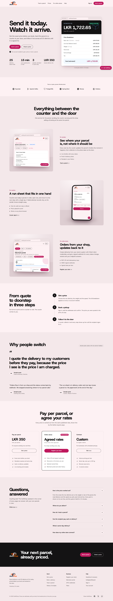

SwiftDrop is the Group 02 (Avengers) project for Enterprise Application Development at the Faculty of Information
Technology, University of Moratuwa. Customers get an exact price and book a pickup; couriers update each parcel from
their phones; dispatchers balance the fleet; online stores create orders through an API and receive signed webhooks;
everyone follows the parcel live; and an AI assistant answers questions with the caller's own data.

## Contents

- [What it does](#what-it-does)
- [Architecture](#architecture)
- [Technology](#technology)
- [Screenshots](#screenshots)
- [Getting started](#getting-started)
- [Engineering](#engineering)
- [Quality: tests and coverage](#quality-tests-and-coverage)
- [Delivery: CI/CD, images and Kubernetes](#delivery-cicd-images-and-kubernetes)
- [Documentation](#documentation)
- [Team](#team)

## What it does

| Who | What they can do |
|---|---|
| Guest | Get an exact delivery price for any two of the 25 districts, track a parcel by number, ask the assistant |
| Customer | Book a delivery with a map pin or address search, follow it live, download PDF receipts, set notification preferences |
| Courier | Open today's run sheet on a phone, move each parcel to its next valid status, capture proof of delivery |
| Dispatcher | Assign and reassign parcels with zone matching and least-loaded suggestions, watch courier workloads, read reports |
| Merchant | Register a store, get API credentials, create orders with idempotency keys, receive HMAC-signed webhooks |
| Admin | Manage users and staff, approve merchants, maintain zones, rate cards, fees and handling, replay dead letters, read the SMS inbox |

## Architecture

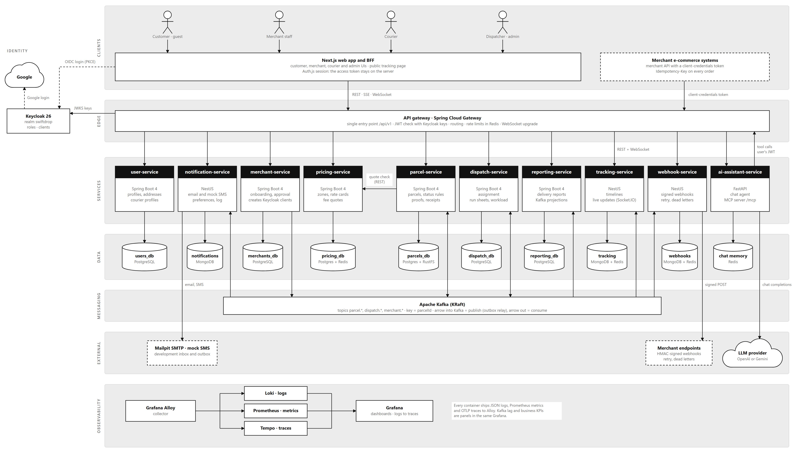

Every request enters through the Next.js BFF, which keeps the access token on the server, and the Spring Cloud
Gateway, which validates the Keycloak JWT, routes, rate-limits per caller in Redis and upgrades WebSockets. Each
service owns its store (database per service) and the services integrate through Kafka. Only three services call
outside systems: e-mail and SMS, signed merchant webhooks, and the LLM provider.

| Layer | Contents |
|---|---|
| Client | Next.js 16 web app for every role, public tracking page, merchant e-commerce systems |
| Edge | Spring Cloud Gateway: single `/api/v1` entry point, JWT check, routing, Redis rate limits, 503 on unreachable services |
| Services | user, merchant, pricing, parcel, dispatch, reporting (Spring Boot 4) · tracking, notification, webhook (NestJS) · ai-assistant (FastAPI + MCP) |
| Data | PostgreSQL per service, MongoDB read models, Redis (quotes, rate limits, sockets, queues, chat memory), RustFS (S3) for proofs |
| Messaging | Kafka (KRaft), transactional outbox, idempotent consumers, dead-letter topics |
| Identity | Keycloak realm `swiftdrop`: OIDC with PKCE, Google sign-in, realm roles, client credentials for merchants |
| Observability | Grafana Alloy collecting logs (Loki), metrics (Prometheus) and traces (Tempo), Grafana dashboards per milestone |

### Event-driven integration

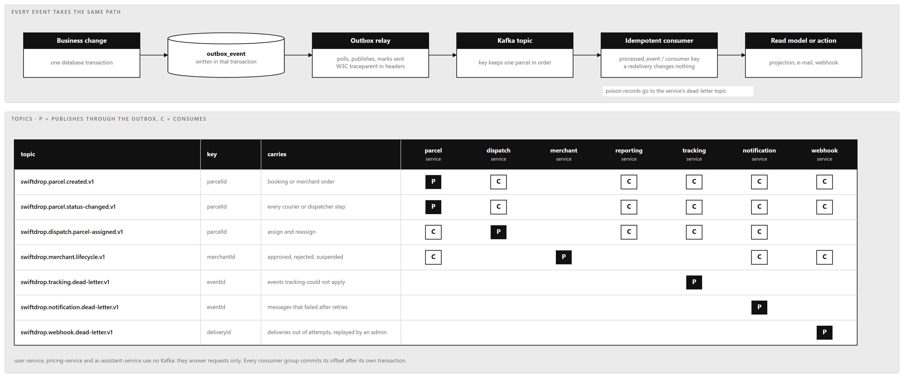

### Deployment

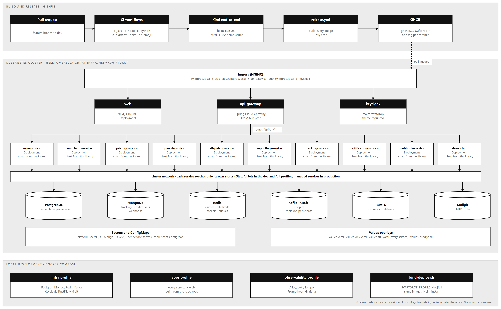

More system figures: [data model of every database](doc/diagrams/system/system-er-diagram.png) and the
[EER diagram of the whole domain](doc/diagrams/system/system-eer-diagram.png). Every milestone's figures are indexed in
[doc/diagrams](doc/diagrams/README.md).

## Technology

| Area | Choice |
|---|---|
| Web | Next.js 16 (App Router), React 19, Tailwind CSS 4, Auth.js v5, Leaflet, Socket.IO client |
| Java services | Java 21, Spring Boot 4, Spring Cloud Gateway, Spring Security resource server, Flyway, Resilience4j, ArchUnit |
| Node services | NestJS 11, kafkajs, Socket.IO with the Redis adapter, BullMQ, MongoDB driver |
| Python service | FastAPI, OpenAI-compatible agent loop (OpenAI, Gemini, Vertex AI), Model Context Protocol server |
| Data and messaging | PostgreSQL 16, MongoDB 7, Redis 7, Kafka (KRaft), RustFS |
| Identity | Keycloak 26 with a SwiftDrop login theme |
| Quality | JUnit 5, Testcontainers, JaCoCo, Jest, Vitest, Testing Library, pytest, Playwright |
| Delivery | Docker Compose profiles, Helm (library + umbrella charts), kind, GitHub Actions, GHCR, Trivy |
| Observability | OpenTelemetry, Micrometer, prom-client, Grafana Alloy, Loki, Tempo, Prometheus, Grafana |

## Screenshots

### AI delivery assistant

The chat assistant sits on every page. Guests can ask for prices; signed-in users can ask about their own parcels,
because the assistant's tools call SwiftDrop with the user's own token. Personal data is masked before it reaches
the language model.

<table>
  <tr>
    <td width="50%" valign="top"><a href="doc/screenshots/17-ai-assistant-guest-price.png">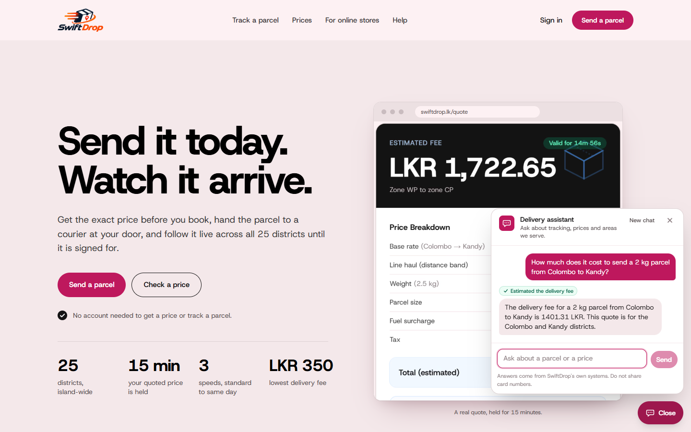</a><br><sub>A guest asks for a price: Colombo to Kandy, 2 kg</sub></td>
    <td width="50%" valign="top"><a href="doc/screenshots/18-ai-assistant-customer-tracking.png">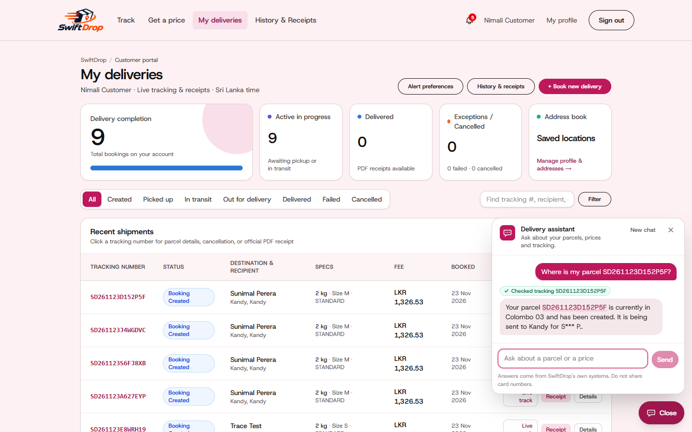</a><br><sub>A signed-in customer asks where their parcel is</sub></td>
  </tr>
</table>

### Web app

<table>
  <tr>
    <td width="50%" valign="top"><a href="doc/screenshots/00-landing-desktop.png"></a><br><sub>Landing page</sub></td>
    <td width="50%" valign="top"><a href="doc/screenshots/02-public-quote.png">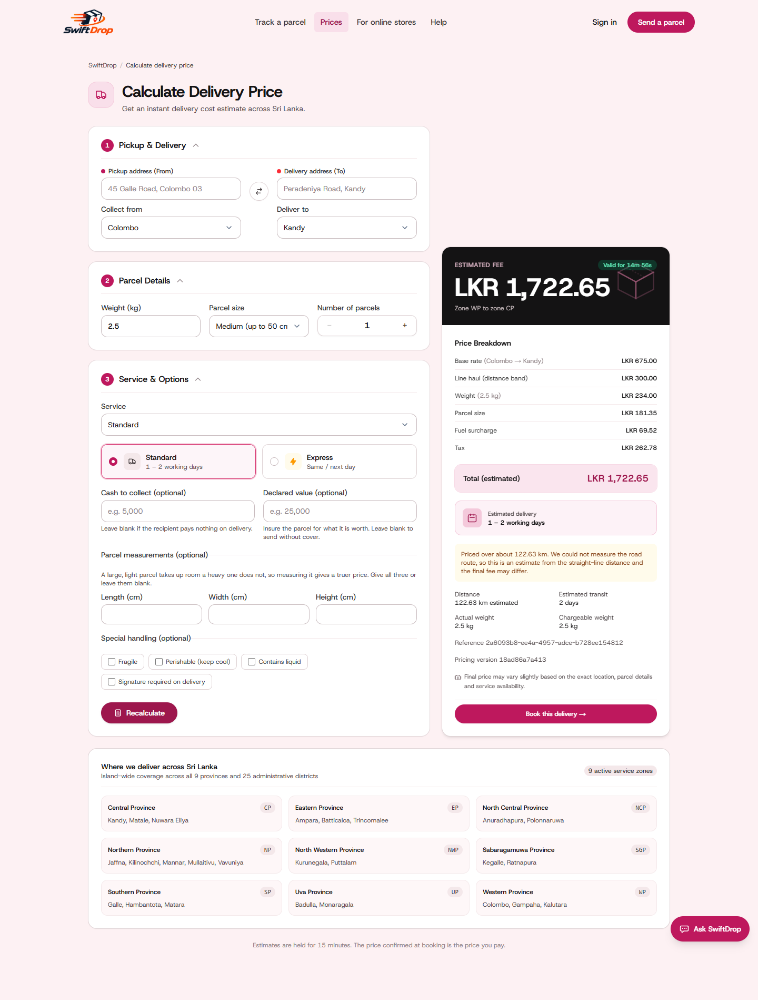</a><br><sub>Price calculator with a live quote</sub></td>
  </tr>
  <tr>
    <td width="50%" valign="top"><a href="doc/screenshots/11-customer-book.png">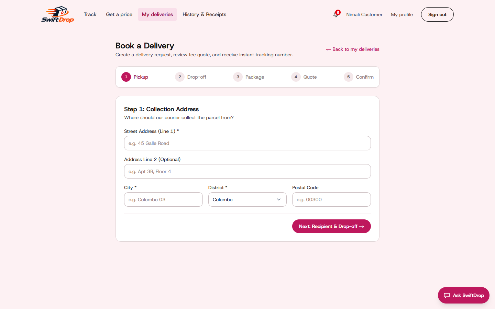</a><br><sub>Booking wizard</sub></td>
    <td width="50%" valign="top"><a href="doc/screenshots/15-customer-parcel-detail.png">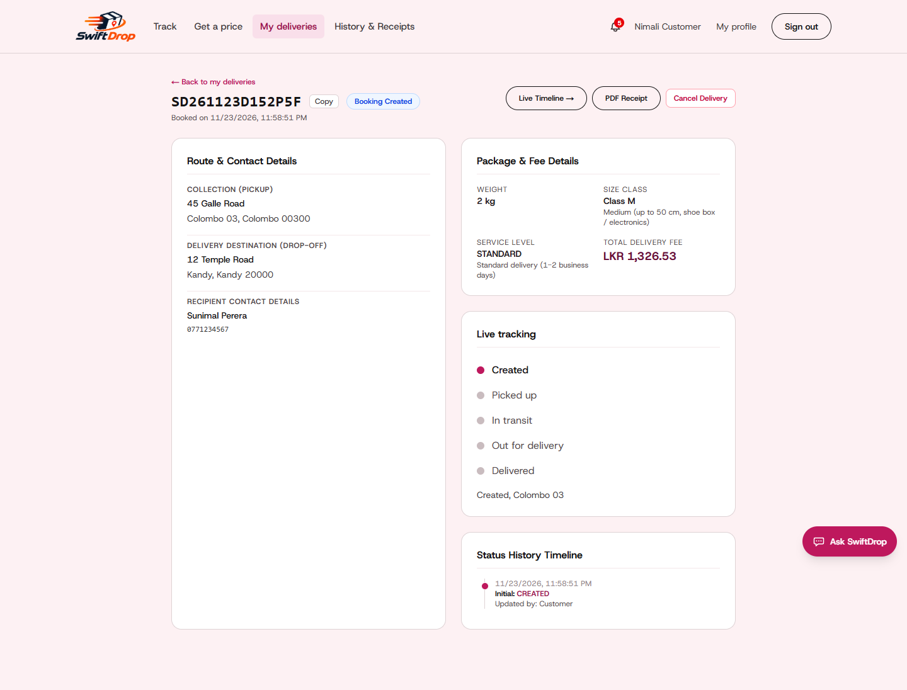</a><br><sub>Parcel detail with live timeline</sub></td>
  </tr>
  <tr>
    <td width="50%" valign="top"><a href="doc/screenshots/09-public-track-result.png">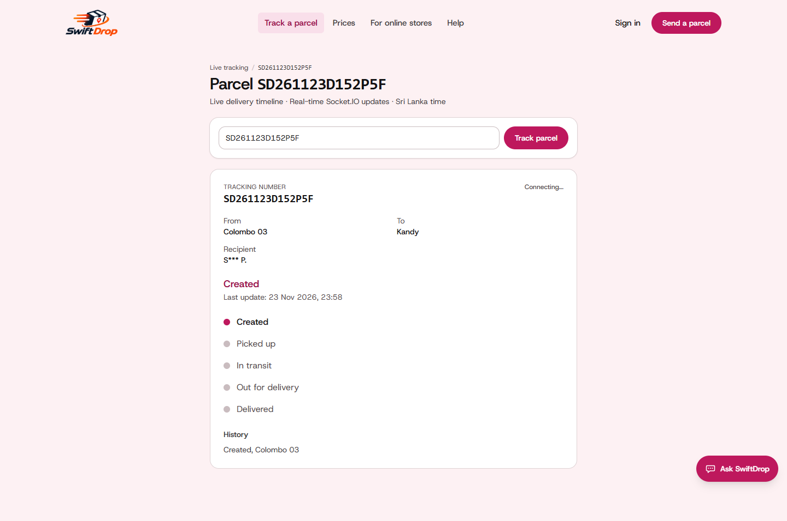</a><br><sub>Public tracking page</sub></td>
    <td width="50%" valign="top"><a href="doc/screenshots/12-customer-history.png">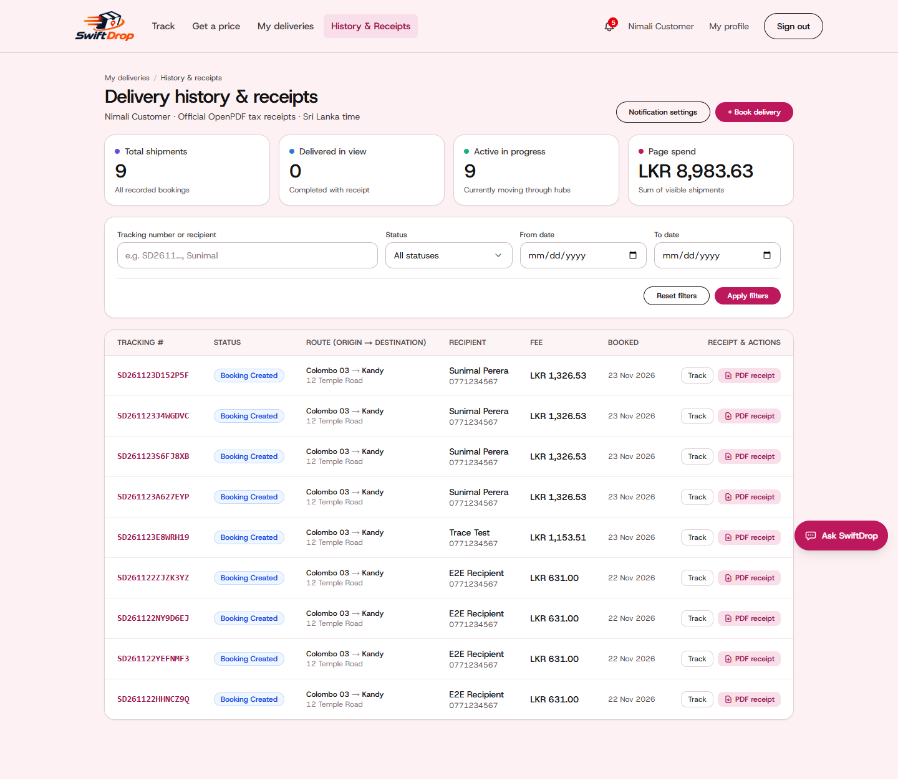</a><br><sub>Delivery history and receipts</sub></td>
  </tr>
  <tr>
    <td width="50%" valign="top"><a href="doc/screenshots/31-courier-parcel.png">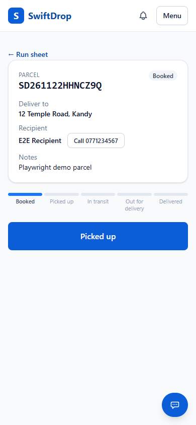</a><br><sub>Courier parcel screen (phone)</sub></td>
    <td width="50%" valign="top"><a href="doc/screenshots/40-dispatcher-dispatch-board.png">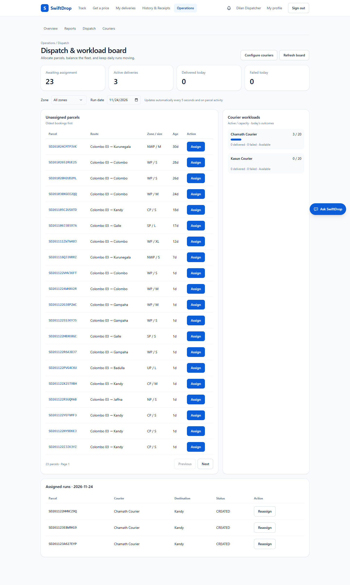</a><br><sub>Dispatch and workload board</sub></td>
  </tr>
  <tr>
    <td width="50%" valign="top"><a href="doc/screenshots/60-admin-reports.png">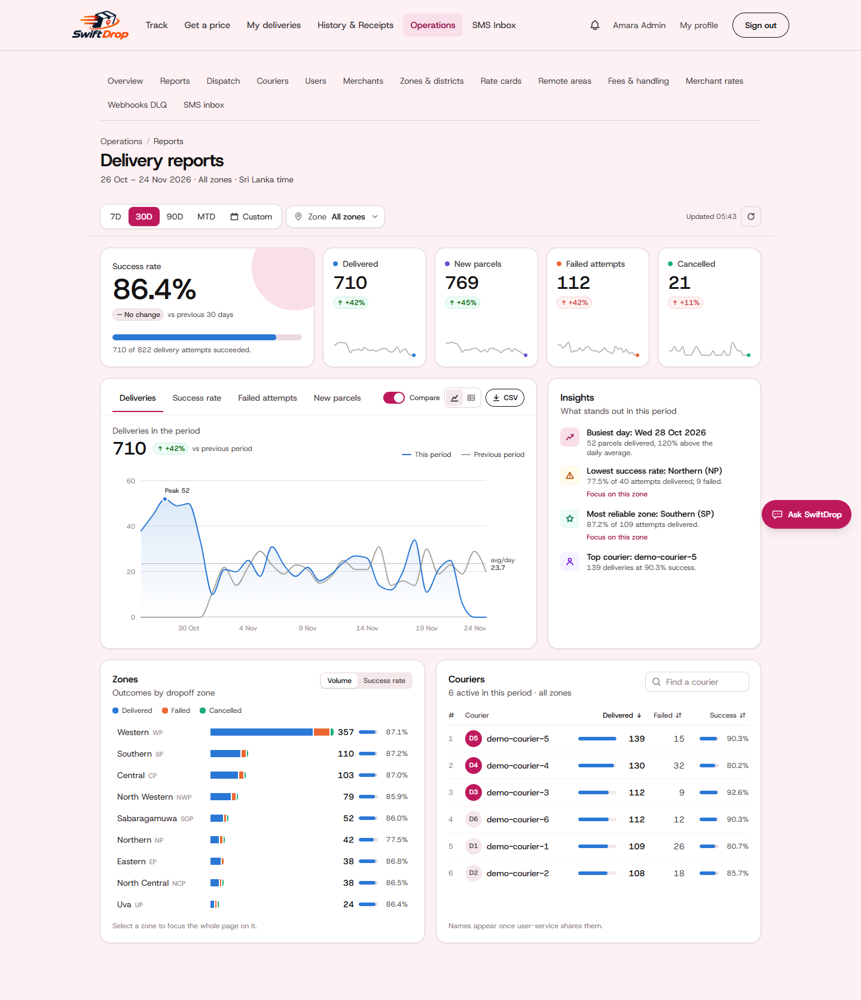</a><br><sub>Delivery reports</sub></td>
    <td width="50%" valign="top"><a href="doc/screenshots/56-admin-pricing-settings.png">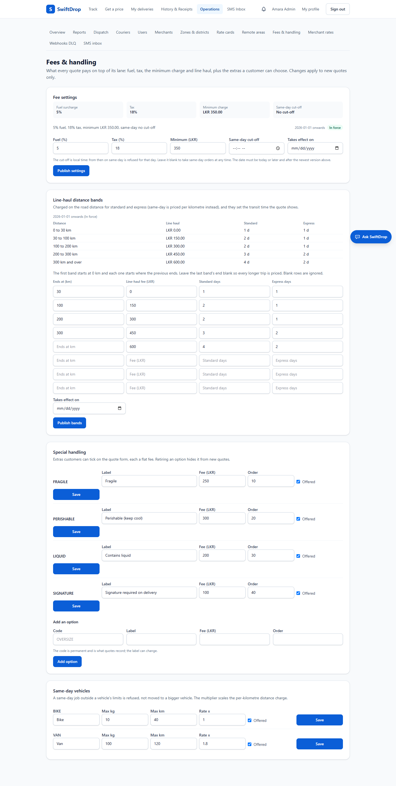</a><br><sub>Fees and handling (pricing admin)</sub></td>
  </tr>
  <tr>
    <td width="50%" valign="top"><a href="doc/screenshots/20-merchant-home.png">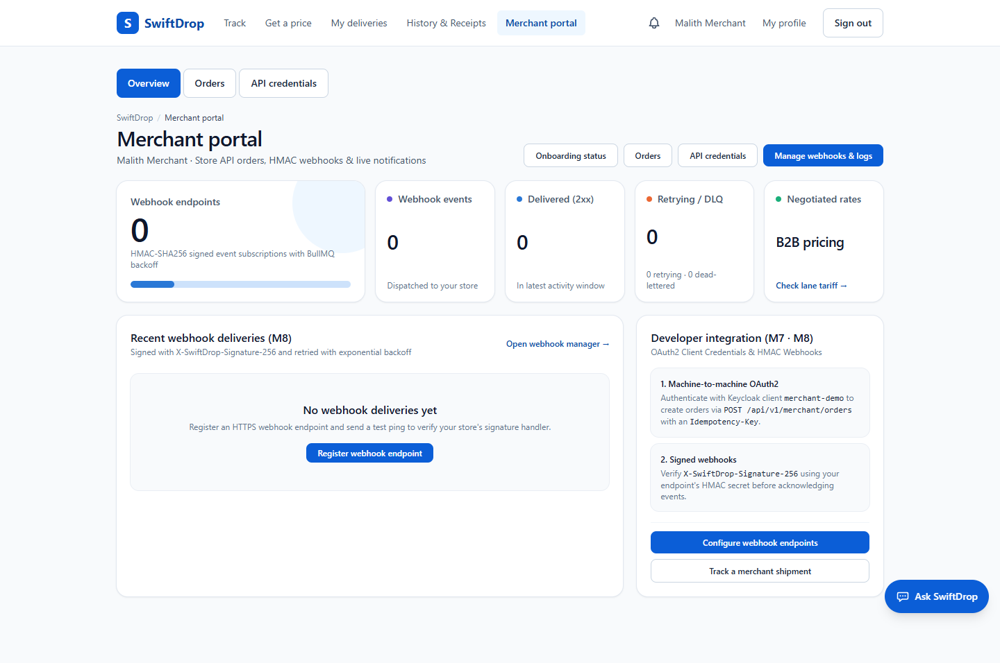</a><br><sub>Merchant portal</sub></td>
    <td width="50%" valign="top"><a href="doc/screenshots/80-grafana-parcels-webhooks.png">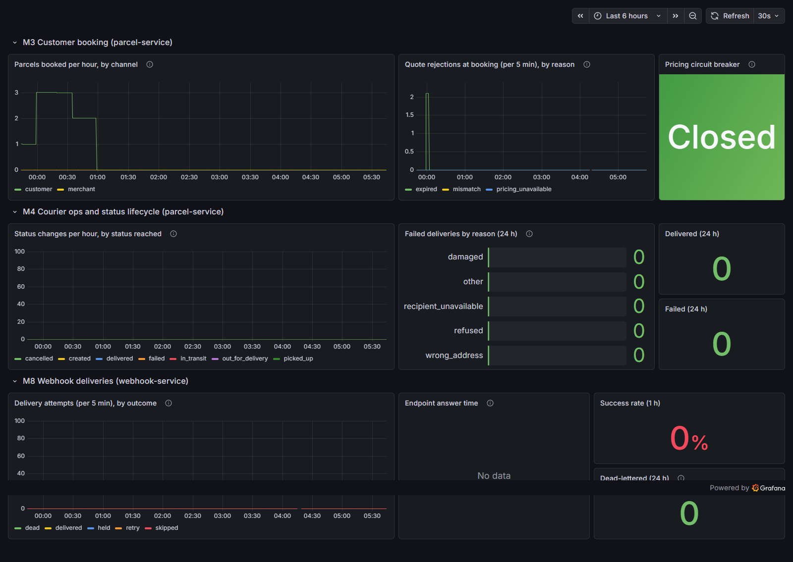</a><br><sub>Grafana: bookings, courier ops and webhooks</sub></td>
  </tr>
</table>

All 52 screens, one per page and role plus the tools and the AI assistant, are in [doc/screenshots](doc/screenshots/README.md).

## Getting started

### Prerequisites

| Tool | Version | Used for |
|---|---|---|
| Docker Desktop | 4.x (≥ 8 GB RAM for the full stack) | infrastructure + containers |
| Java (Temurin) | 21 | Spring Boot services |
| Maven | 3.9+ | Java build |
| Node.js | 22.12+ | NestJS services, web app |
| pnpm | 10 (`corepack enable`) | Node workspace |
| uv | 0.11+ | Python AI service |

### Quick start

```bash
pnpm install            # Node workspace (web app, Nest services, shared lib)
pnpm env:init           # creates .env with freshly generated secrets (never commit it)
pnpm infra:up           # Postgres, Keycloak, Kafka (+topics), Mongo, Redis, RustFS, Mailpit, Kafka UI
pnpm obs:up             # optional: + Grafana, Loki, Tempo, Prometheus, Alloy
pnpm web:dev            # Next.js on http://localhost:3000
```

Run a service on your machine while the rest runs in Docker (it reads the root `.env` automatically):

```bash
mvn -pl services/parcel-service -am spring-boot:run           # Java service
mvn -pl services/api-gateway -am spring-boot:run              # gateway on :8080
pnpm --filter @swiftdrop/tracking-service dev                 # Nest service
cd services/ai-assistant-service && uv run uvicorn app.main:app --reload --port 8095
```

Everything in containers (first build takes a while):

```bash
pnpm stack:up           # profiles infra + observability + apps
pnpm stack:ps
pnpm stack:down
```

#### Local URLs

| What | URL | Credentials |
|---|---|---|
| Web app | http://localhost:3000 | demo users below |
| API gateway | http://localhost:8080 | Bearer token |
| Keycloak admin | http://localhost:8180/admin | `KEYCLOAK_ADMIN_USER` / `KEYCLOAK_ADMIN_PASSWORD` from `.env` |
| Kafka UI | http://localhost:8088 | — |
| Mailpit (emails) | http://localhost:8026 | — |
| RustFS console (S3) | http://localhost:9011 | `S3_ACCESS_KEY` / `S3_SECRET_KEY` |
| Grafana | http://localhost:3001 | `GRAFANA_ADMIN_USER` / `GRAFANA_ADMIN_PASSWORD` |
| Prometheus | http://localhost:9090 | — |
| Postgres | localhost:15432 | per-service users, password `SWIFTDROP_DB_PASSWORD` |

Host ports are configurable in `.env` (defaults avoid clashing with other local stacks).

#### Demo users (Keycloak realm `swiftdrop` & `users_db`)

Password for all demo accounts: **`Swift@2026`** (configurable via `KC_SEED_USER_PASSWORD` in `.env`).

| Email | Password | Roles | Default Web Portal | Fixed User ID (JWT `sub`) | Seeded Profile / Notes |
|---|---|---|---|---|---|
| `admin@swiftdrop.lk` | `Swift@2026` | `ADMIN`, `CUSTOMER` | `/admin` | `10000000-0000-4000-8000-000000000001` | Full Operations, Pricing, Reports, Couriers, Webhooks DLQ & SMS Inbox access |
| `dispatcher@swiftdrop.lk` | `Swift@2026` | `DISPATCHER`, `CUSTOMER` | `/admin/dispatch` | `10000000-0000-4000-8000-000000000002` | Dispatch board, courier directory (`read`), and delivery reports |
| `courier1@swiftdrop.lk` | `Swift@2026` | `COURIER`, `CUSTOMER` | `/courier` | `10000000-0000-4000-8000-000000000003` | Vehicle: `BIKE`, Home zone: `WP` (Western), Capacity: `25/day`, `assignable: true` |
| `courier2@swiftdrop.lk` | `Swift@2026` | `COURIER`, `CUSTOMER` | `/courier` | `10000000-0000-4000-8000-000000000004` | Vehicle: `VAN`, Home zone: `CP` (Central), Capacity: `40/day`, `assignable: true` |
| `customer@swiftdrop.lk` | `Swift@2026` | `CUSTOMER` | `/customer` | `10000000-0000-4000-8000-000000000005` | Saved default pickup address (`45 Galle Road, Colombo 03`), bookings & PDF receipts |
| `merchant@swiftdrop.lk` | `Swift@2026` | `MERCHANT`, `CUSTOMER` | `/merchant` | `10000000-0000-4000-8000-000000000006` | Claim `merchant_id: 00000000-0000-4000-8000-000000000001`, webhook endpoints & logs |

The ids are fixed in the realm file, so `pnpm keycloak:reimport` keeps them and data that refers to a demo user
(profiles, addresses, courier assignments) stays valid. Users created by hand or through Google get a new id on
every re-import.

Machine client for the merchant API: `merchant-demo` (client credentials, secret `KC_DEMO_MERCHANT_CLIENT_SECRET`).

#### Optional manual setup (external keys & road routing)

Everything else works out of the box after `pnpm env:init` and `pnpm infra:up`. The following integrations are optional:

1. **AI Delivery Assistant (`ai-assistant-service`):** set `GEMINI_API_KEY` (when `LLM_PROVIDER=gemini`) or `OPENAI_API_KEY` (when `LLM_PROVIDER=openai`) in `.env` and restart `ai-assistant-service` to enable live LLM tool-calling answers in the chat widget. Without a key, the service still starts and `/mcp` tools work directly.
2. **Google OAuth login:** create an OAuth client in Google Cloud Console. The redirect URI is
   `http://localhost:8180/realms/swiftdrop/broker/google/endpoint` locally, and
   `https://auth.<your-host>/realms/swiftdrop/broker/google/endpoint` on the public site. Put
   `GOOGLE_CLIENT_ID` / `GOOGLE_CLIENT_SECRET` in `.env`, then re-import the realm: `pnpm keycloak:reimport`.
   A realm that is already running does not pick up the new client secret from that file. Update the
   Google identity provider in the Keycloak admin console as well.
3. **Real email:** parcel mail reads `SMTP_HOST`, `SMTP_PORT`, `SMTP_FROM`, `SMTP_USER`, `SMTP_PASSWORD`
   and `SMTP_SECURE`. Leave the user and password empty for Mailpit. Keycloak's own verification and
   password-reset mail uses the realm email settings, which stay on Mailpit until you change them.
4. **OSRM road-routed same-day distances:** run `pnpm routing:up` and set `OSRM_URL=http://localhost:15000` (or `http://osrm:5000` in Compose) in `.env`. When `OSRM_URL` is blank, `pricing-service` automatically falls back to Haversine road-distance estimation.

Get a token for API testing (dev-only `swiftdrop-test` client):

```bash
curl -s -d grant_type=password -d client_id=swiftdrop-test \
     -d username=customer@swiftdrop.lk -d password='Swift@2026' \
     http://localhost:8180/realms/swiftdrop/protocol/openid-connect/token
curl -H "Authorization: Bearer <access_token>" http://localhost:8080/api/v1/parcels/meta/whoami
```

---

## Engineering

### Repository layout

```
apps/web/                 Next.js 16 (App Router) — all UIs + BFF (/api/bff/*), Auth.js + Keycloak
services/                 one folder per microservice
  api-gateway/            Spring Cloud Gateway — JWT validation, routing, CORS, rate limiting, correlation ids
  user-service/ merchant-service/ pricing-service/ parcel-service/ dispatch-service/ reporting-service/   (Spring Boot)
  tracking-service/ notification-service/ webhook-service/                                               (NestJS)
  ai-assistant-service/   FastAPI + MCP
libs/
  java/                   parent POM, common-logging, common-web, common-security, events, outbox
  node/swiftdrop-common/  event types + validation, Kafka consumer template, JWT, logger, Nest module
  python/swiftdrop_common/  logging, JWT, FastAPI problem+json
contracts/
  events/                 Kafka event JSON Schemas (+ examples) — the source of truth
  openapi/                REST contracts per service (v1)
infra/                    keycloak realm, postgres init, kafka topics, observability config, helm
tools/templates/          service templates used by `pnpm new-service`
scripts/                  env bootstrap, service generator
doc/                      architecture, plan, contribution sheet, diagrams, test reports
```

Every Java service has the same layers — `api` (presentation) → `application` (use cases) → `domain`
(plain Java) → `infrastructure` (adapters) — enforced by an ArchUnit test. Nest services mirror this per feature module.

#### Adding a service

```bash
pnpm new-service --type java --name loyalty-service --port 8087 --route loyalty --db loyalty_db --db-user loyalty_svc --kafka
pnpm new-service --type nest --name chat-service --port 8093 --route chat --mongo
```

### Shared conventions (all stacks)

- **Auth:** every endpoint needs a Keycloak JWT (issuer + audience `swiftdrop-api` checked) unless explicitly public.
  Inject the caller as `AuthenticatedUser` (Java), `@CurrentUser()` (Nest) or `Depends(current_user)` (FastAPI).
- **Errors:** RFC 9457 `application/problem+json` with `code`, `traceId`, `timestamp`; never stack traces or personal data.
- **Correlation:** `X-Correlation-Id` is created at the gateway and copied into logs and events.
- **Rate limiting:** Spring Cloud Gateway `RequestRateLimiter` with token buckets in Redis, shared by every gateway replica: 300 requests a minute per signed-in user or merchant API client (`client_id`), 60 per IP for anonymous callers (`GATEWAY_RATE_LIMIT_*`). Over the limit the gateway answers `429` with `Retry-After`; if Redis is down, requests are let through. The web server passes the visitor IP on, and the gateway believes `X-Forwarded-For` only from `GATEWAY_TRUSTED_PROXIES`.
- **Unavailable services:** when the service behind a route cannot be reached, the gateway answers `503` problem+json (`SERVICE_UNAVAILABLE`) without naming the service.
- **Logs:** one JSON object per line (`@timestamp, level, service, message, correlationId, traceId`); emails, phones,
  passwords and tokens are masked automatically.
- **Events:** published only through the outbox (`OutboxWriter.publish(...)`), consumed idempotently.
- **Config:** environment variables only; secrets live in `.env` (local) or Kubernetes Secrets.

### Observability and debugging with Grafana

SwiftDrop provides a complete LGTM (Loki, Grafana, Tempo, Prometheus) observability stack orchestrated with Grafana Alloy.
How the signals flow is drawn in [`doc/diagrams/m9-notifications-receipts/13-architecture-observability.png`](doc/diagrams/m9-notifications-receipts/13-architecture-observability.png)
(source: `13-architecture-observability.mmd`).

#### 1. Starting the Observability Stack

```bash
pnpm obs:up
```

Open Grafana at [http://localhost:3001](http://localhost:3001) using credentials `GRAFANA_ADMIN_USER` / `GRAFANA_ADMIN_PASSWORD` (defaults in `.env`: `admin` / `admin`).

#### 2. Available Dashboards

- **SwiftDrop - Platform Overview (`swiftdrop-platform`):** Real-time cluster health, RED metrics (Rate, Errors, Duration), Kafka consumer lag across all topics, and active error log streams.
- **SwiftDrop - Notifications & Business KPIs (`swiftdrop-m9-observability`):** Real-time delivery status transitions, OpenPDF receipts generated, email/SMS notification throughput, and JVM/Node.js memory metrics.
- **SwiftDrop - Bookings, courier ops and webhooks (`swiftdrop-parcels-webhooks`):** bookings per hour by channel, quote
  rejections by reason and the pricing circuit breaker (M3); status changes per hour and failed deliveries by reason
  (M4); webhook attempts by outcome, endpoint answer time, success rate and dead letters (M8).

Dashboards are provisioned from `infra/observability/grafana/dashboards/`. Saving, adding or deleting a JSON file
there shows up in Grafana within about 10 seconds, also on Windows and macOS: Docker Desktop does not pass file
events into Grafana, so the `grafana-dashboard-sync` container calls Grafana's provisioning reload API whenever the
folder changes (`infra/observability/grafana/sync/reload-on-change.sh`).

#### 3. Distributed Tracing with Tempo

One trace follows a request from `api-gateway` through the service that handles it, across Kafka and into
every consumer:

- **Java services** use Spring Boot's OpenTelemetry starter (from `swiftdrop-common-logging`); compose sets
  `MANAGEMENT_OPENTELEMETRY_TRACING_EXPORT_OTLP_ENDPOINT=http://alloy:4318/v1/traces` and samples every request
  (`TRACING_SAMPLING_PROBABILITY`, default `1.0`).
- **Across Kafka**: the outbox stores the request's W3C `traceparent` with each event and the relay sends it as a
  Kafka header, so consumers continue the same trace even though the event is published later.
- **Node services** (tracking, notification, webhook) import `@swiftdrop/common/tracing` first; it instruments
  HTTP and kafkajs. **ai-assistant-service** instruments FastAPI and its httpx calls to the gateway.
- Without an OTLP endpoint nothing is exported, so tests and local runs are unaffected.

Follow one booking end to end:
1. Book a parcel (web app or `POST /api/v1/parcels`).
2. Open **Explore**, choose **Tempo**, search with `{ resource.service.name = "parcel-service" }` (or
   `api-gateway`) and open the newest `POST /api/v1/parcels` trace.
3. The trace shows the gateway span, parcel-service with its pricing call, and, after the outbox relay
   publishes, the Kafka consumers: tracking-service, notification-service, webhook-service, dispatch-service and
   reporting-service.

#### 4. Trace-to-Log Correlation

1. Within Tempo trace view, click **Trace to Logs** to view matching logs in **Loki**.
2. Every log line contains the matching `traceId` and `correlationId`.
3. PII (customer email, phone number, physical address) is automatically sanitized in logs before ingestion.

#### 5. Inspecting Notification Dead Letters and Consumer Lag

If notification delivery encounters persistent failures:
1. Check **Kafka Consumer Lag** panel on the M9 dashboard.
2. Failed events are routed to `swiftdrop.notification.dead-letter.v1` after max retry attempts (default: 3).
3. View dead-letter payload and original failure stack trace in Kafka UI at [http://localhost:8088](http://localhost:8088).

## Quality: tests and coverage

```bash
mvn verify                                   # Java: unit + Testcontainers ITs + JaCoCo gate (>= 70% lines)
pnpm -r test                                 # Node libraries, services and the web app (Jest / Vitest, >= 70%)
cd libs/python/swiftdrop_common && uv run pytest
cd services/ai-assistant-service && uv run pytest
pnpm e2e                                     # Playwright demo suite against the running stack
pnpm test:reports                            # collect every report into doc/test-reports
```

Every module is held to at least 70% line coverage in CI. The latest numbers for every module, and the end-to-end
results, are in [doc/test-reports/SUMMARY.md](doc/test-reports/SUMMARY.md); the HTML reports sit beside it.

## Delivery: CI/CD, images and Kubernetes

| Workflow | What it does |
|---|---|
| `ci-java.yml`, `ci-node.yml`, `ci-python.yml` | Build and test each stack with the coverage gate |
| `ci-platform.yml` | Compose config, Keycloak realm, contract files |
| `helm.yml`, `helm-e2e.yml` | Lint and render the charts; install on kind and run the M2 demo end to end |
| `release.yml` | Build every image, scan it with Trivy, push to GHCR with provenance and an SBOM |
| `no-emoji.yml` | Keeps emojis out of code, commits and pull requests |

Kubernetes: `infra/helm` holds a library chart, one thin chart per service and an umbrella chart with dev
datastores and an NGINX ingress. `SWIFTDROP_PROFILE=full ./scripts/kind-deploy.sh` installs every service on kind;
see [infra/helm/README.md](infra/helm/README.md).

### Git workflow

Read [CONTRIBUTING.md](CONTRIBUTING.md) first. In short:

- `main` is protected: changes only through pull requests with one approving review and a green `no-emoji` check.
- Branch per feature: `feat/m<N>-<topic>`; Conventional Commits (`feat:`, `fix:`, `test:` …).
- **No emojis** anywhere in the repository, commits, pull requests or issues (`python scripts/check-no-emoji.py`).

See [Demo users](#demo-users-keycloak-realm-swiftdrop) above for the roles and credentials to log in with.

### Container images

Every merge to `main` (and every `v*.*.*` tag) runs [`release.yml`](.github/workflows/release.yml): it builds one image per
service plus the web app, scans each with Trivy, and publishes it to the GitHub Container Registry:

```
ghcr.io/pasidu-mihiranga/swiftdrop-<service>:sha-<short-sha>   # immutable: pin this in Helm values / compose
ghcr.io/pasidu-mihiranga/swiftdrop-<service>:main              # newest build of main (also :latest)
ghcr.io/pasidu-mihiranga/swiftdrop-<service>:1.2.3             # on a v1.2.3 tag (also :1.2)
```

`<service>` is the folder name under `services/` (e.g. `reporting-service`), or `web` for `apps/web`.

- **Release gate:** an image with a *critical* vulnerability that already has a fix is not published. Fix it by bumping the
  base image or the dependency; if that is impossible for now, record the CVE with a reason in [`.trivyignore`](.trivyignore).
  Pull requests that change a Dockerfile run the same build and scan without publishing.
- **Supply chain:** published images carry OCI labels linking them to this repository, a provenance attestation and an SBOM.
- **Pulling:** GHCR creates new packages as private. After the first release, set each `swiftdrop-*` package to public
  (Package settings, Change visibility) so kind/minikube can pull without credentials, or create an image pull secret.

## Documentation

| Document | Contents |
|---|---|
| [Final report (PDF)](doc/SwiftDrop-Final-Report.pdf) | Repository and setup, design documentation, test reports and coverage, contribution sheet. Rebuilt by `python scripts/final-report/build.py` |
| [Design documentation (PDF)](doc/design/SwiftDrop-Design-Documentation.pdf) | Whole-system and per-feature design: use cases, data models, architecture, integration, key flows, patterns |
| [doc/design](doc/design/README.md) | Each member's own design document |
| [doc/diagrams](doc/diagrams/README.md) | Every figure, system and per milestone, in the M10 template |
| [doc/01-architecture.md](doc/01-architecture.md) | Architecture, services, data model, security, flows, patterns |
| [doc/02-implementation-plan.md](doc/02-implementation-plan.md) | Phases, testing, DevOps, demo checklist |
| [doc/03-team-contribution.md](doc/03-team-contribution.md) | Contribution sheet |
| [doc/06-integration-guide.md](doc/06-integration-guide.md) | How the services integrate |
| [contracts/](contracts/) | OpenAPI contracts per service and Kafka event JSON Schemas |
| [doc/test-reports](doc/test-reports/SUMMARY.md) | Coverage summary and HTML test reports |

## Team

Group 02 · Avengers · Faculty of Information Technology, University of Moratuwa.

| # | Feature | Owner | Index | Diagrams | Design |
|---|---|---|---|---|---|
| M1 | Identity & Access | T.M. Warsavithana (ThisukaMW) | 234219R | [m1-identity-access](doc/diagrams/m1-identity-access/) | [doc](doc/design/m1-identity-access-design.md) |
| M2 | Pricing & Zones | S.J. Wijewardana (sasindu345) | 234241C | [m2-pricing-zones](doc/diagrams/m2-pricing-zones/) | [doc](doc/05-m2-design-notes.md) |
| M3 | Customer Booking | M.A.M. Pahasara (Malshipahasara) | 234151B | [m3-customer-booking](doc/diagrams/m3-customer-booking/) | [doc](doc/design/m3-customer-booking-design.md) |
| M4 | Courier Ops & Status Lifecycle | W.P.P. Welikada (pamindu-w) | 234224D | [m4-courier-operations](doc/diagrams/m4-courier-operations/) | [team PDF](doc/design/SwiftDrop-Design-Documentation.pdf) |
| M5 | Dispatch & Workload | W.M.C.S. Wijekoon (Chaniths) | 234232B | [m5-dispatch-workload](doc/diagrams/m5-dispatch-workload/) | [doc](doc/design/m5-dispatch-workload-design.pdf) |
| M6 | Real-time Tracking | K.W.A. Imalsha (ashmax77) | 234086E | [m6-real-time-tracking](doc/diagrams/m6-real-time-tracking/) | [team PDF](doc/design/SwiftDrop-Design-Documentation.pdf) |
| M7 | Merchant Onboarding & API | K.K.G. Saputhanthri (KavinuS) | 234189X | [m7-merchant-onboarding](doc/diagrams/m7-merchant-onboarding/) | [doc](doc/design/m7-merchant-onboarding-design.pdf) |
| M8 | Webhooks & External Integration | W.C.G.H. Fernando (geemalfernando) | 234063G | [m8-webhooks-integration](doc/diagrams/m8-webhooks-integration/) | [team PDF](doc/design/SwiftDrop-Design-Documentation.pdf) |
| M9 | Notifications, History & Receipts | K.P.S.M. Pathirana (sapuni-pathirana) | 234152E | [m9-notifications-receipts](doc/diagrams/m9-notifications-receipts/) | [doc](doc/design/m9-notifications-receipts-design.pdf) |
| M10 | Reporting & AI Assistant | P.M. Ilamperuma (Pasidu-Mihiranga) | 234083R | [m10-reporting-ai-assistant](doc/diagrams/m10-reporting-ai-assistant/) | [doc](doc/design/m10-reporting-ai-assistant-design.pdf) |
