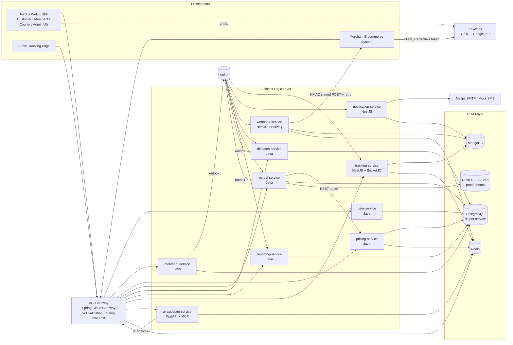
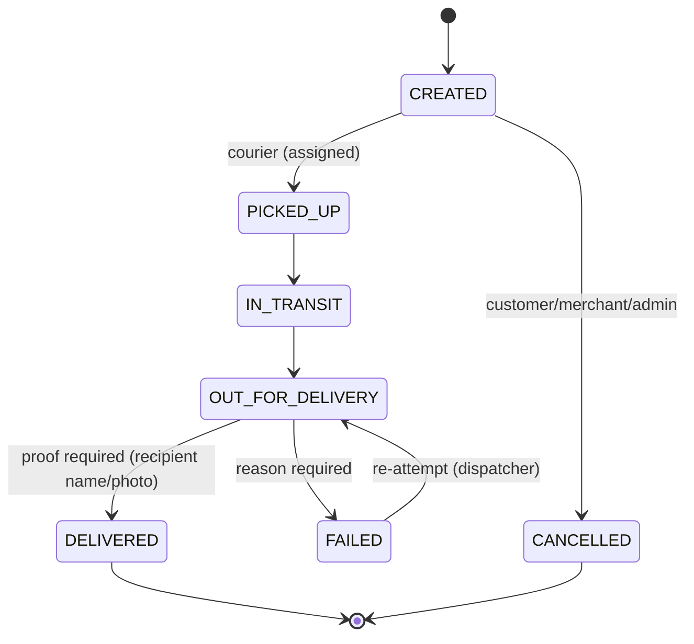
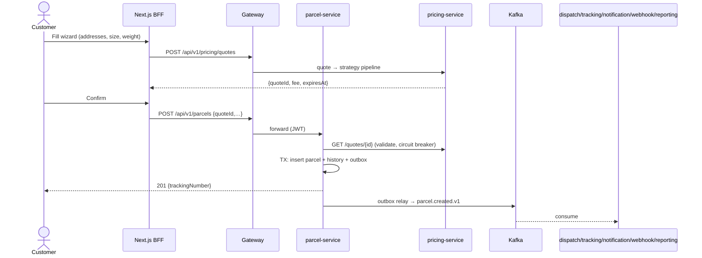
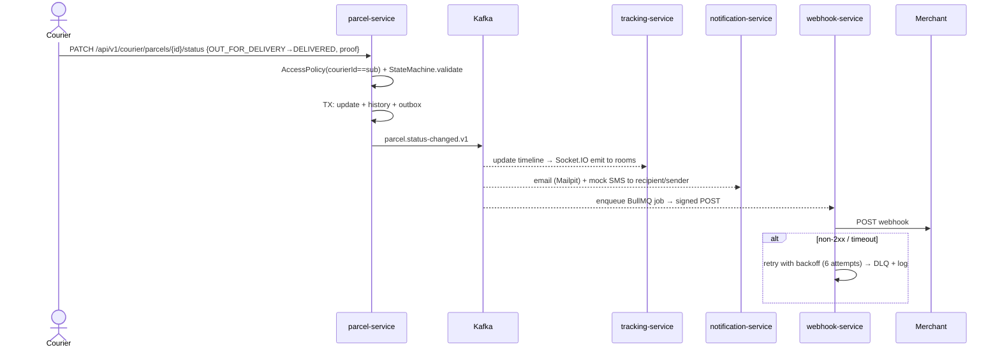

# SwiftDrop — System Architecture

> **SwiftDrop docs:** [01 Architecture](01-architecture.md) · [02 Implementation Plan](02-implementation-plan.md) · [03 Team & Contribution](03-team-contribution.md)

## Context

SwiftDrop is an island-wide (Sri Lanka) courier company that currently runs on phone calls and spreadsheets. The assignment asks for an enterprise-grade Parcel Delivery & Courier Management System covering Customers, Merchants, Couriers and Dispatchers/Admins, with real-time tracking, pub/sub integration, webhooks, notifications, containerisation, testing, and bonus marks for Kubernetes and an AI assistant.

The repository (`C:\Users\PMIHIR\Desktop\EAD\SwiftDrop`) is empty (git initialised, no commits). This plan defines the full architecture, monorepo folder structure, technology stack, data model, integration design, security, observability, testing, DevOps and a **feature-by-feature split for 10 members, each doing an equal share of frontend and backend work**.

**Decisions confirmed with the user**
| Area | Choice |
|---|---|
| Backend | Polyglot microservices: **Java 21 / Spring Boot 4** core, **Node.js / NestJS 11** for event-driven edge services, **Python 3.12 / FastAPI** for the AI assistant |
| Frontend | **Next.js 16 (App Router, TypeScript)** with Auth.js v5, which also acts as the **BFF** |
| Identity | **Keycloak 26** (OIDC/OAuth 2.0, Google identity brokering, client-credentials for merchants) |
| Messaging | **Apache Kafka (KRaft mode)** |
| Data | Polyglot: **PostgreSQL 16** (transactional), **MongoDB 7** (timelines/logs), **Redis 7** (cache, rate limit, queues, sockets) |
| Observability | Full **LGTM**: Loki + Grafana + Tempo + Prometheus (Mimir not needed), shipped through **Grafana Alloy** with OpenTelemetry |
| LLM | **OpenAI or Gemini**, switchable with `LLM_PROVIDER` (both through an OpenAI-compatible client) |
| Bonus | Kubernetes + Helm, AI assistant + MCP, CI/CD with GitHub Actions |


## 1. Architecture Overview

**Style:** Microservices + API Gateway + BFF (Next.js) + event-driven integration (Kafka), with database-per-service. Each service is internally **layered/hexagonal** (presentation → application → domain → infrastructure).

**Why this style**
- Independent scaling: tracking (WebSocket fan-out) and parcel (write-heavy) scale separately from admin and reporting.
- Independent ownership: one service or feature per team member, so parallel development has little merge conflict.
- Async decoupling: a status change fans out to tracking, notification, webhook, dispatch and reporting without the parcel service knowing about any of them (Observer / pub-sub).
- Polyglot fit: Java for transactional domain logic, Node for I/O-heavy event and socket work, Python for the LLM/MCP ecosystem.
- Trade-offs we accept: eventual consistency and more operational complexity. Mitigations: Outbox, idempotent consumers, distributed tracing and centralised logs.



### 1.1 Service Catalogue

| Service | Lang | Port | Store | Responsibility |
|---|---|---|---|---|
| `api-gateway` | Spring Cloud Gateway | 8080 | Redis | Single entry point `/api/v1/**`. Validates JWTs (Keycloak JWKS), routes requests and WebSockets, applies rate limiting per user/client (Redis), CORS, and propagates the correlation ID. |
| `user-service` | Spring Boot | 8081 | Postgres `users_db` | User profiles (JIT-provisioned from JWT), address book, courier profiles, mirror of roles, admin user management (Keycloak Admin API adapter). |
| `merchant-service` | Spring Boot | 8082 | Postgres `merchants_db` | Merchant registration, admin approval workflow, provisioning Keycloak confidential clients (client credentials), credential rotation. |
| `pricing-service` | Spring Boot | 8083 | Postgres `pricing_db` + Redis | Zones, district→zone map, rate cards, size classes, fee quote (Strategy + Decorator), quotes cached with a TTL. |
| `parcel-service` | Spring Boot | 8084 | Postgres `parcels_db` + S3 (RustFS) | Parcel aggregate, tracking number, status **state machine**, status history, proof of delivery, merchant order API (idempotency), receipt PDF, transactional **outbox** → Kafka. |
| `dispatch-service` | Spring Boot | 8085 | Postgres `dispatch_db` | Unassigned pool (read model), assign/reassign courier, courier daily run sheet, workload projection. |
| `reporting-service` | Spring Boot | 8086 | Postgres `reporting_db` | Event projections: deliveries per day/zone/courier, success/failure rate. |
| `tracking-service` | NestJS | 8090 | MongoDB `tracking` + Redis | Timeline read model, public tracking API (PII-masked), Socket.IO real-time push (rooms per tracking number, per user, dispatcher board). |
| `notification-service` | NestJS | 8091 | MongoDB `notifications` | Consumes events, uses a channel Strategy (Email via SMTP → Mailpit, mock SMS), Handlebars templates, preferences, notification log, SMS inbox for the demo. |
| `webhook-service` | NestJS | 8092 | MongoDB `webhooks` + Redis (BullMQ) | Owns merchant webhook subscriptions and signing secrets (secrets never travel over Kafka); webhook fan-out, HMAC-SHA256 signing, exponential-backoff retry, dead-letter queue, delivery log, manual replay. |
| `ai-assistant-service` | FastAPI | 8095 | Redis (chat memory) | Chat endpoint (SSE streaming), LLM provider Strategy (OpenAI/Gemini), **MCP server** exposing SwiftDrop tools. |
| `web` | Next.js | 3000 | — | All UIs and the BFF (route handlers keep tokens server-side). |
| `merchant-simulator` (tools) | Node/Express | 4000 | in-memory | Demo "online store": gets a token, creates orders, receives and verifies webhooks, and shows them on a page. |

**Infra containers (default host ports, configurable in `.env`):** Kafka (KRaft) 9092, Kafka UI 8088, Keycloak 8180, Postgres 15432, MongoDB 27018, Redis 6380, RustFS (S3) 9010/9011, Mailpit 1026/8026, Prometheus 9090, Loki 3100, Tempo 3200, Alloy 4317/4318/12345, Grafana 3001.

> MinIO no longer publishes community Docker images, so S3-compatible storage is provided by **RustFS** (Apache-2.0); the AWS S3 SDK works unchanged.

### 1.2 Communication Matrix (Integration Patterns)

| Pattern | Where | Why |
|---|---|---|
| **Request/Reply (sync REST)** | Web→Gateway→services; parcel→pricing (quote validation); merchant→Keycloak Admin API | The user needs an immediate answer (fee estimate, create confirmation). Protected with Resilience4j circuit breaker, timeout and retry. |
| **Publish/Subscribe (Kafka)** | `parcel.*`, `dispatch.*`, `merchant.*` events | One status change, many independent reactions. Adding a consumer needs no producer change (Open/Closed). |
| **Transactional Outbox** | parcel, dispatch, merchant services | Avoids the dual-write problem: the DB row and the event commit atomically, then a relay publishes to Kafka. |
| **Idempotent Consumer** | All consumers (a `processed_event` table/collection keyed by `eventId`) | Kafka is at-least-once delivery. |
| **CQRS read models** | dispatch (unassigned pool, workload), tracking (timeline), reporting (stats) | Fast queries without cross-service joins or N+1 calls. |
| **Webhook (HTTP callback) + Retry + DLQ** | webhook-service → merchants | External systems are unreliable. Backoff 30s, 2m, 10m, 30m, 2h, 6h, then DLQ and admin replay. |
| **WebSocket push** | tracking-service → browsers | Real-time tracking without polling. Redis adapter allows horizontal scaling. |
| **API Gateway / BFF** | Gateway + Next.js route handlers | One security choke point; tokens never reach browser JavaScript. |
| **Partitioning by key** | Kafka key = `parcelId` | Guarantees status events stay in order per parcel. |

### 1.3 Kafka Topics

Event envelope (JSON, schemas in `contracts/events/*.schema.json`):
```json
{ "eventId":"uuid", "eventType":"ParcelStatusChanged", "eventVersion":1,
  "occurredAt":"ISO-8601", "correlationId":"uuid", "producer":"parcel-service",
  "data":{ "parcelId":"…", "trackingNumber":"…", "fromStatus":"IN_TRANSIT", "toStatus":"OUT_FOR_DELIVERY",
           "merchantId":"…|null", "customerId":"…|null", "courierId":"…", "note":"…", "failureReason":null } }
```

| Topic | Key | Producer | Consumers (group) |
|---|---|---|---|
| `swiftdrop.parcel.created.v1` (6 partitions) | parcelId | parcel | dispatch, tracking, notification, webhook, reporting |
| `swiftdrop.parcel.status-changed.v1` (6) | parcelId | parcel | tracking, notification, webhook, dispatch, reporting |
| `swiftdrop.dispatch.parcel-assigned.v1` (6) | parcelId | dispatch | parcel (sets courierId), tracking, notification |
| `swiftdrop.merchant.lifecycle.v1` (3) | merchantId | merchant | notification (approval email), webhook (pause deliveries to suspended merchants), parcel (merchant status cache) |
| `swiftdrop.webhook.dead-letter.v1` (3) | deliveryId | webhook | monitoring / admin |
| `swiftdrop.notification.dead-letter.v1` (3) | eventId | notification | monitoring |

Topic names carry the version (`.v1`) so a breaking change creates `.v2`, which can run alongside `.v1`.

### 1.4 Parcel State Machine (State pattern in `parcel-service`)


Assignment is an attribute (`courierId`), not a status. Only the assigned courier (or an admin) may move a parcel forward. Failure reasons come from an enum: `RECIPIENT_UNAVAILABLE, WRONG_ADDRESS, REFUSED, DAMAGED, OTHER(+note)`.

---

## 2. Monorepo Folder Structure

```
SwiftDrop/
├── apps/
│   └── web/                              # Next.js (UI + BFF)
├── services/
│   ├── api-gateway/                      # Spring Cloud Gateway
│   ├── user-service/                     # Spring Boot
│   ├── merchant-service/                 # Spring Boot
│   ├── pricing-service/                  # Spring Boot
│   ├── parcel-service/                   # Spring Boot
│   ├── dispatch-service/                 # Spring Boot
│   ├── reporting-service/                # Spring Boot
│   ├── tracking-service/                 # NestJS
│   ├── notification-service/             # NestJS
│   ├── webhook-service/                  # NestJS
│   └── ai-assistant-service/             # FastAPI + MCP
├── libs/
│   ├── java/
│   │   ├── swiftdrop-parent/             # parent POM: versions, plugins, JaCoCo gate
│   │   ├── swiftdrop-common-logging/     # JSON log layout + PII masking (servlet and reactive)
│   │   ├── swiftdrop-common-web/         # ProblemDetail handler, correlation-id filter, API exceptions
│   │   ├── swiftdrop-common-security/    # JWT resource-server config, Keycloak role converter, @CurrentUser
│   │   ├── swiftdrop-events/             # Event envelope + event DTOs (generated from contracts/events)
│   │   └── swiftdrop-outbox/             # Outbox + relay + idempotent consumer, ships its own Flyway migrations
│   ├── node/
│   │   └── swiftdrop-common/             # Kafka module (kafkajs), idempotency, JWT guard, pino logger, OTel, exception filter
│   └── python/
│       └── swiftdrop_common/             # JSON logging + PII masking, JWT verification, FastAPI problem+json
├── contracts/
│   ├── openapi/                          # <service>.v1.yaml + common.v1.yaml
│   └── events/                           # JSON Schemas for every Kafka event + examples/ (validated by Java and Node tests)
├── infra/
│   ├── docker/                           # compose override files, .env.example
│   ├── keycloak/                         # realm-swiftdrop.json (roles, clients, Google IdP, mappers), theme/
│   ├── postgres/init/                    # 01-create-databases.sh (one database + role per service)
│   ├── kafka/                            # create-topics.sh
│   ├── observability/
│   │   ├── alloy/config.alloy
│   │   ├── prometheus/prometheus.yml
│   │   ├── loki/ tempo/
│   │   └── grafana/provisioning/{datasources,dashboards}/
│   └── helm/
│       ├── swiftdrop/                    # umbrella chart (values-dev.yaml, values-prod.yaml)
│       ├── swiftdrop-service/            # LIBRARY chart: Deployment/Service/HPA/ConfigMap/Secret templates (DRY)
│       └── charts/<service>/             # thin per-service charts that use the library chart
├── tools/
│   ├── templates/                        # java-service, nest-service templates for `pnpm new-service`
│   └── merchant-simulator/
├── tests/
│   ├── e2e/                              # Playwright demo flows
│   └── load/                             # k6 scripts (optional)
├── doc/
│   ├── 01-architecture.md  02-implementation-plan.md  03-team-contribution.md
│   ├── diagrams/                         # PlantUML/Mermaid sources + exported PNG
│   └── test-reports/                     # coverage summaries for submission
├── .github/
│   ├── workflows/                        # ci-java.yml, ci-node.yml, ci-python.yml, ci-web.yml, release.yml, helm.yml
│   ├── CODEOWNERS
│   └── pull_request_template.md
├── docker-compose.yml                    # profiles: infra | observability | apps
├── Makefile                              # Linux/macOS shortcuts (Windows: pnpm scripts)
├── scripts/                              # init-env.mjs (.env with generated secrets), new-service.mjs
├── pom.xml                               # Maven aggregator for libs/java + Java services
├── package.json / pnpm-workspace.yaml    # pnpm workspace: apps/web, Node services, libs/node, tools
├── .env.example
└── README.md
```

### 2.1 Java service template (example `parcel-service`, package `lk.swiftdrop.parcel`)
```
parcel-service/
├── src/main/java/lk/swiftdrop/parcel/
│   ├── ParcelServiceApplication.java
│   ├── api/                       # PRESENTATION
│   │   ├── v1/                    # ParcelController, CourierStatusController, MerchantOrderController
│   │   ├── dto/                   # request/response records + Bean Validation
│   │   └── mapper/                # MapStruct mappers
│   ├── application/               # BUSINESS / USE CASES
│   │   ├── command/               # CreateParcelUseCase, UpdateStatusUseCase …
│   │   ├── query/                 # ParcelQueryService
│   │   └── port/out/              # PricingPort, ProofStoragePort, EventPublisherPort (interfaces – DIP)
│   ├── domain/                    # PURE DOMAIN (no Spring)
│   │   ├── model/                 # Parcel (aggregate), ParcelStatus, StatusHistory, TrackingNumber
│   │   ├── state/                 # ParcelState implementations (State pattern)
│   │   ├── policy/                # ParcelAccessPolicy (ownership rules)
│   │   └── exception/
│   └── infrastructure/            # DATA + ADAPTERS
│       ├── persistence/           # JPA entities, Spring Data repositories, PII AttributeConverter
│       ├── messaging/             # Kafka consumers (parcel-assigned), outbox wiring
│       ├── client/                # PricingRestClient (RestClient + Resilience4j)
│       ├── storage/               # S3ProofStorage (RustFS locally)
│       └── config/
├── src/main/resources/{application.yml, db/migration/V1__init.sql}
├── src/test/java/…/{unit, integration, architecture}/   # ArchUnit enforces the layer rules
├── Dockerfile                     # multi-stage, layered jar, non-root, distroless/temurin-jre
└── pom.xml
```

### 2.2 NestJS service template (example `webhook-service`)
```
webhook-service/
├── src/
│   ├── main.ts  app.module.ts
│   ├── config/                    # @nestjs/config + zod env validation
│   ├── modules/
│   │   ├── subscriptions/         # merchant config cache (from compacted topic)
│   │   ├── delivery/              # signer.ts (HMAC), dispatcher.ts, delivery.processor.ts (BullMQ)
│   │   ├── logs/                  # controller + Mongo schema (admin/merchant log view, replay)
│   │   └── consumers/             # parcel-events.consumer.ts
│   ├── common/                    # filters, guards (JWT/roles), interceptors
│   └── health/
├── test/{unit,integration}/
├── Dockerfile  package.json  tsconfig.json
```

### 2.3 FastAPI template (`ai-assistant-service`)
```
ai-assistant-service/
├── app/
│   ├── main.py
│   ├── api/v1/chat.py             # POST /chat (SSE stream)
│   ├── agent/                     # orchestrator.py (tool-calling loop), prompts.py, guardrails.py
│   ├── llm/                       # base.py (LLMProvider protocol), openai_provider.py, gemini_provider.py, factory.py
│   ├── mcp_server/                # server.py (FastMCP, streamable HTTP at /mcp), tools/*.py
│   ├── clients/swiftdrop_api.py   # httpx client to the gateway (forwards the user's JWT)
│   └── core/                      # config.py (pydantic-settings), security.py, logging.py
├── tests/
├── pyproject.toml  Dockerfile
```

### 2.4 Next.js app (`apps/web`)
```
apps/web/src/
├── app/
│   ├── (public pages)             # landing, /track/[trackingNumber], /quote, /login
│   ├── customer/                  # dashboard, parcels/new, parcels/[id], history
│   ├── merchant/                  # register, dashboard, orders, credentials, webhooks
│   ├── courier/                   # today, parcels/[id]/update   (mobile-first)
│   ├── admin/                     # dispatch, workload, users, merchants, zones, pricing, reports, webhooks, sms-inbox
│   ├── api/auth/[...nextauth]/    # Auth.js v5 + Keycloak provider
│   └── api/bff/[...path]/         # BFF proxy → gateway, attaches the access token server-side
├── features/<feature>/{components,hooks,api,schemas}/    # feature-sliced (one folder per member feature)
├── components/ui/                 # shadcn/ui + Tailwind
├── lib/                           # api-client, auth, socket (socket.io-client), formatters
└── proxy.ts                       # role-based route protection (Next.js 16 "proxy", formerly middleware)
```
Tooling: TanStack Query, React Hook Form + Zod, Recharts (reports), next-intl optional (EN/Sinhala/Tamil).

---

## 3. Data Model (ER, per service)

**users_db**: `user_profile(id = keycloak sub PK, full_name, email, phone_enc, status, created_at)`, `role(code PK)`, `user_role(user_id, role_code)` (mirrored from Keycloak), `address(id, user_id FK, label, line1_enc, line2_enc, city, district, postal_code, lat, lng)`, `courier_profile(user_id PK/FK, vehicle_type, home_zone_id, max_daily_capacity, active)`.

**merchants_db**: `merchant(id, owner_user_id, business_name, br_number, contact_email, phone_enc, status[PENDING|APPROVED|REJECTED|SUSPENDED], reviewed_by, reviewed_at, rejection_reason)`, `api_credential(id, merchant_id, keycloak_client_id, created_at, rotated_at, revoked_at)`, `outbox_event`.

**pricing_db**: `zone(id, code, name, active)`, `district_zone(district PK, zone_id)`, `size_class(code[S|M|L|XL] PK, max_weight_kg, max_dimensions_cm, multiplier)`, `rate_card(id, from_zone_id, to_zone_id, base_fee, per_kg_fee, express_multiplier, cod_fee_pct, effective_from, effective_to)`. Quotes are held in Redis `quote:{id}` with a 15-minute TTL.

**parcels_db**: `parcel(id, tracking_number UQ, source[CUSTOMER|MERCHANT], customer_id, merchant_id, merchant_order_ref, pickup_address_enc jsonb, dropoff_address_enc jsonb, pickup_zone_id, dropoff_zone_id, recipient_name, recipient_phone_enc, weight_kg, size_class, service_level, fee, currency, quote_id, status, courier_id, created_at, updated_at, version)`, `parcel_status_history(id, parcel_id FK, from_status, to_status, actor_id, actor_role, note, failure_reason, proof_id, lat, lng, occurred_at)`, `delivery_proof(id, parcel_id, type[NAME|PHOTO|SIGNATURE], recipient_name, object_key, created_at)`, `idempotency_record(key, merchant_id, parcel_id, request_hash, created_at)`, `outbox_event(id, aggregate_id, event_type, payload jsonb, created_at, published_at)`.

**dispatch_db**: `parcel_summary(parcel_id PK, tracking_number, pickup_zone_id, dropoff_zone_id, size_class, status, created_at)` (read model), `assignment(id, parcel_id, courier_id, assigned_by, run_date, status[ACTIVE|COMPLETED|REASSIGNED], assigned_at)`, `courier_workload(courier_id PK, active_count, delivered_today, failed_today, updated_at)`, `processed_event`, `outbox_event`.

**reporting_db**: `daily_delivery_stats(date, zone_id, created, delivered, failed, cancelled)`, `courier_daily_stats(date, courier_id, delivered, failed)`, `processed_event`.

**MongoDB**: `tracking.timelines {trackingNumber, parcelId, ownerIds, currentStatus, events[], publicView{city, maskedRecipient}}`, `notifications.logs`, `notifications.sms_outbox`, `notifications.preferences`, `webhooks.deliveries {deliveryId, merchantId, eventId, url, attempts[{at, httpStatus, latencyMs, error}], status}`, `webhooks.merchant_configs`.

The ER diagram in the design PDF is a single logical ER across all services, with service-boundary colouring. Cross-service references are IDs only, never foreign keys.

---

## 4. Security Design

- **Keycloak realm `swiftdrop`.** Realm roles: `CUSTOMER, MERCHANT, COURIER, DISPATCHER, ADMIN`. Clients:
  - `swiftdrop-web` (confidential, Auth.js, Authorization Code + PKCE)
  - `swiftdrop-api` (bearer-only; the audience every access token must carry)
  - `user-service-admin` (service account allowed to manage users, e.g. create couriers)
  - `merchant-demo` (pre-provisioned demo merchant for the simulator)
  - `swiftdrop-test` (DEV ONLY: password grant for Postman/integration tests)
  - `merchant-service-admin` (service account allowed to manage clients/users)
  - `merchant-<id>` (one per approved merchant: client-credentials, `merchant_id` hard-coded claim mapper, role `MERCHANT_API`)
  - `swiftdrop-mcp` (for external MCP clients)
- **Google login:** Keycloak Identity Brokering with Google. The first-broker-login flow auto-assigns `CUSTOMER`. The UI calls `signIn("keycloak", {}, { kc_idp_hint: "google" })`.
- **JWT everywhere:** the gateway validates and every service is *also* an OAuth2 resource server (defence in depth). Spring uses `@PreAuthorize` + a domain `AccessPolicy`; NestJS uses `RolesGuard`; FastAPI uses a dependency.
- **Ownership rules (tested):** a courier sees only parcels where `courierId == sub`; a customer only their own; a merchant only rows with its `merchant_id` claim; only ADMIN approves merchants and edits pricing; DISPATCHER/ADMIN assign. A foreign resource returns **404** so existence isn't leaked.
- **Merchant API:** `POST /api/v1/merchant/orders` with a client-credentials token, a required `Idempotency-Key` header, and per-client gateway rate limiting. Merchants verify webhooks with `X-SwiftDrop-Signature: t=<ts>,v1=<HMAC-SHA256(secret, ts.body)>` and reject anything older than 5 minutes.
- **PII:** phone numbers and address lines are encrypted at rest with an AES-GCM JPA `AttributeConverter` (key from env/Secret). Bean Validation, Zod and Pydantic validate input on every boundary. A logback/pino masking pattern hides phone and email. Errors use RFC 9457 `ProblemDetail` with no stack traces or PII, plus a `traceId` for support. The public tracking page shows only city and masked recipient name (`K*** P.`).
- **Secrets:** nothing hard-coded. `.env` (git-ignored) plus `.env.example`; K8s Secrets; GitHub Actions secrets.
- **Uploads:** S3 presigned PUT (RustFS locally), 5 MB limit, image MIME whitelist, random object keys, private bucket, short-lived presigned GET.
- **Other:** HTTPS via Ingress TLS in K8s, CSP/security headers in Next.js, and dependency + image scanning (Trivy, Dependabot).

---

## 5. Key Flows (go into the design PDF as sequence diagrams)

**5.1 Customer creates a delivery**


**5.2 Merchant API order:** Merchant → Keycloak `/token` (client_credentials) → Gateway (JWT + rate limit) → parcel-service `MerchantOrderController`. It checks the `merchant_id` claim and merchant status, checks the idempotency key, quotes inline, persists and writes the outbox → `parcel.created.v1` → webhook-service POSTs a `parcel.created` webhook to the merchant.

**5.3 Courier status update → notifications**


**5.4 OAuth 2.0 / Google login:** Browser → Next.js `/api/auth/signin` → Keycloak `/auth` (PKCE, `kc_idp_hint=google`) → Google consent → Keycloak broker callback (first login: create user, assign CUSTOMER) → redirect with code → Auth.js exchanges the code for tokens → encrypted HTTP-only session cookie → BFF calls the gateway with a bearer token. On first `/users/me`, user-service JIT-creates the profile. Refresh is handled server-side by Auth.js.

Also required for the PDF: use-case diagrams for the 4 actors, the ER diagram, an architecture/deployment diagram, and an activity diagram for the webhook retry and the dispatcher assignment.

---

## 6. Design Patterns & Principles (for the design note)

| Pattern | Where |
|---|---|
| Strategy | Pricing rules (`ZoneMatrixStrategy`, `WeightStrategy`), notification channels (Email/SMS), LLM providers (OpenAI/Gemini) |
| Decorator / Chain | Pricing surcharges (size, express, COD) layered on the base fee |
| State | Parcel status transitions |
| Observer / Pub-Sub | Kafka events → consumers |
| Repository | Spring Data / Mongoose repositories |
| Adapter / Ports & Adapters | Keycloak Admin, S3 storage, SMTP, SMS, Pricing client |
| Factory | Tracking-number generator (`SD` + YYMMDD + base32 + Luhn check), event factory |
| Outbox, Idempotent Consumer, CQRS | Integration reliability |
| Circuit Breaker / Retry | Resilience4j (Java), BullMQ backoff (webhooks) |
| Facade / BFF | Next.js route handlers |
| Template Method | Base Kafka consumer (dedupe → handle → ack) in the Node and Java common libs |

**Principles:** SOLID (DIP through ports, OCP through new consumers or strategies), DRY (shared libs + Helm library chart), 12-Factor config, and fail-fast validation. ArchUnit tests enforce the layering.

---

## 7. API Surface (v1, through the gateway `/api/v1`)

- **users:** `GET/PUT /users/me`, `CRUD /users/me/addresses`, `GET/POST/PATCH /admin/users` (create courier/dispatcher, enable/disable), `GET /admin/couriers`
- **merchants:** `POST /merchants/register`, `GET /merchants/me`, `GET /admin/merchants?status=PENDING`, `POST /admin/merchants/{id}/approve|reject`, `POST /merchants/me/credentials/rotate`
- **pricing:** `POST /pricing/quotes` (public), `GET /pricing/zones` (public), `GET /pricing/quotes/{id}` (validation), `CRUD /admin/pricing/zones`, `/admin/pricing/rate-cards`, `/admin/pricing/size-classes`
- **parcels:** `POST /parcels`, `GET /parcels/mine`, `GET /parcels/{id}`, `POST /parcels/{id}/cancel`, `GET /parcels/{id}/receipt` (PDF), `PATCH /courier/parcels/{id}/status`, `POST /courier/parcels/{id}/proof-upload-url`, `POST /merchant/orders`, `GET /merchant/orders`
- **dispatch:** `GET /dispatch/unassigned?zone=`, `POST /dispatch/assignments`, `POST /dispatch/assignments/{id}/reassign`, `GET /dispatch/workloads`, `GET /courier/run-sheet?date=`
- **tracking:** `GET /tracking/public/{trackingNumber}` (public, masked), `GET /tracking/parcels/{id}/timeline` (auth), WS `/ws/tracking`
- **notifications:** `GET /notifications/me`, `PUT /notifications/preferences`, `GET /admin/notifications/sms-inbox`
- **webhooks:** `CRUD /webhooks/endpoints`, `POST /webhooks/endpoints/{id}/test`, `GET /webhooks/deliveries`, `GET /admin/webhooks/deliveries?status=DEAD`, `POST /admin/webhooks/deliveries/{id}/replay`
- **reports:** `GET /reports/daily?from&to`, `/reports/success-rate`, `/reports/couriers` (DISPATCHER/ADMIN)
- **assistant:** `POST /assistant/chat` (SSE), MCP at `/mcp`

Contracts live in `contracts/openapi/<service>.v1.yaml` (shared components in `common.v1.yaml`); each service also serves its live spec (springdoc / `@nestjs/swagger` / FastAPI), aggregated in a Swagger UI at the gateway.

---

## 8. AI Delivery Assistant (Bonus)

- MCP tools (FastMCP): `track_parcel(tracking_number)`, `estimate_delivery_fee(from_city, to_city, weight_kg, size_class="S")`, `list_my_parcels(status?)`, `get_parcel_details(parcel_id)`, `list_service_zones()`.
- The agent loop uses an OpenAI-compatible chat-completions client with function calling. `LLM_PROVIDER=openai|gemini` selects the base URL, model and key (Gemini through its OpenAI-compatible endpoint), so there is one code path.
- The user's JWT is forwarded to the gateway, so the assistant can never see more than the user can. Anonymous users get public tools only.
- Guardrails: a system prompt restricts it to SwiftDrop topics; answers must come from tools (no invented tracking data); the chat endpoint is rate-limited; PII is masked in logs.
- The MCP endpoint is also usable from external MCP clients for the demo.
- Frontend: a floating chat widget on every page with a streaming response and tool-call chips ("Checked tracking SD…").

---

## 9. Observability (LGTM)

- **Logs:** JSON to stdout (logstash-logback-encoder / pino / structlog) with `traceId`, `spanId`, `correlationId`, `service`. Alloy uses Docker/K8s discovery to ship them to **Loki**.
- **Metrics:** Actuator + Micrometer Prometheus, `prom-client`, and `prometheus-fastapi-instrumentator`, scraped by **Prometheus**; plus a kafka-exporter for consumer lag.
- **Traces:** OpenTelemetry SDKs export OTLP to Alloy and on to **Tempo**. Kafka header propagation gives one trace from HTTP request → outbox → consumer → webhook.
- **Grafana dashboards (provisioned as code):**
  - Service RED metrics
  - JVM/Node runtime
  - Kafka lag
  - Business KPIs (parcels created/delivered/failed, webhook success rate)
  - Logs↔traces linking through derived fields

---

