# SwiftDrop — Parcel-service booking (M3)

Design documentation for the booking slice of `parcel-service`. The diagrams in `diagrams/m3/` are the source of this document. Neighbouring milestones appear only where this service calls them or stores a table they own.

**Service:** `parcel-service`  
**Runtime:** Spring Boot, port `8084`  
**Database:** PostgreSQL `parcels_db` (database per service)  
**Public route prefix:** `/api/v1/parcels/**`  
**Gateway audience:** `swiftdrop-api`

## 1. Scope

M3 owns the customer booking path and the read and cancel rules that sit on the same aggregate.

| Use case | Actor | Outcome |
| --- | --- | --- |
| View the estimated fee | Customer | Included in create-delivery. The fee itself comes from the saved quote (M2). |
| Create a delivery request | Customer | A parcel in status `CREATED`, a history row, an outbox row, and a tracking number. |
| List my parcels | Customer | One page of parcels that belong to the caller. |
| View one parcel | Customer, assignee, merchant, or staff | Parcel plus history, with phone and addresses decrypted. |
| Cancel while status is `CREATED` | Customer (the owner) | Status becomes `CANCELLED`, with history and an outbox row. |

A courier or a merchant cannot create a booking. An assignee or a member of staff may open a parcel; any other caller receives `404`.

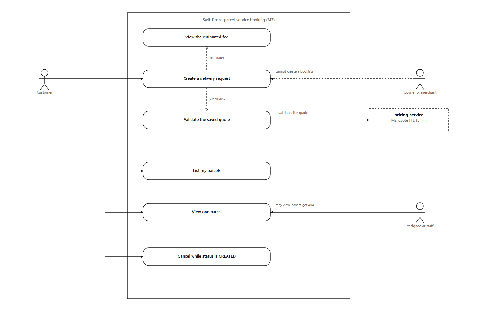

## 2. Place in the platform

```
Booking UI (Next.js)
  session cookie
        │
        ▼
Next.js BFF
  adds the access token server-side
  the browser never holds the token
        │  bearer token
        ▼
Spring Cloud Gateway
  JWT check, audience swiftdrop-api
  route /api/v1/parcels/**
        │  role CUSTOMER on create
        ▼
parcel-service :8084
  CreateParcelUseCase
  CancelParcelUseCase
  ParcelAccessPolicy
        │                         │
        │ validate quote          │ one transaction
        ▼                         ▼
pricing-service (M2)         PostgreSQL parcels_db
  GET /pricing/quotes/{id}        │
  Resilience4j timeout            │ outbox relay
  and circuit breaker             ▼
                              Kafka
                              parcel.created.v1
```

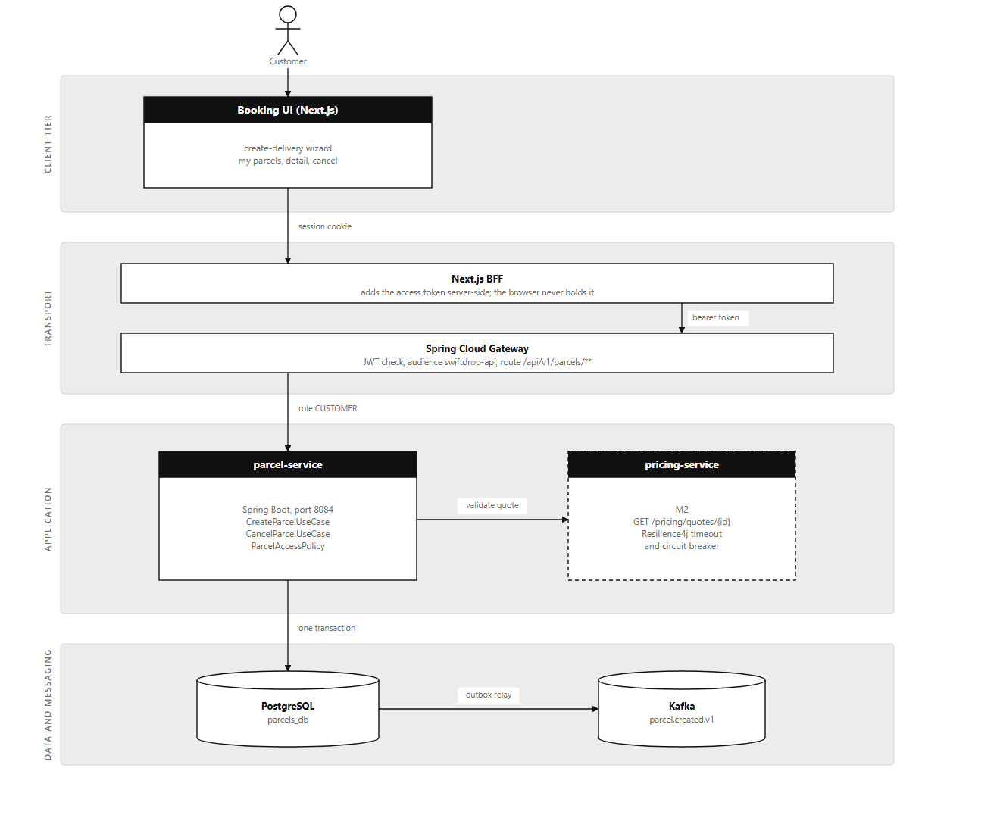

The customer path is synchronous until the tracking number is returned. Everything after the database commit is asynchronous: the outbox relay publishes to Kafka, and dispatch, tracking, and notify subscribe.

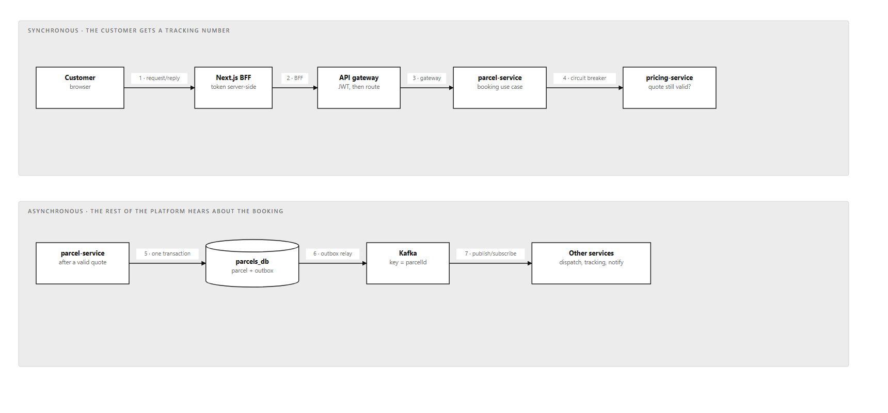

| Step | Path | What happens |
| --- | --- | --- |
| 1 | Browser → BFF | Request and reply. The UI confirms the booking with `quoteId` and addresses. |
| 2 | BFF → gateway | The BFF reads the access token from the session and calls the API. |
| 3 | Gateway → parcel-service | JWT is checked, then the request is routed. `X-Correlation-Id` is forwarded. |
| 4 | parcel-service → pricing-service | Circuit breaker around "is the quote still valid?" |
| 5 | parcel-service → `parcels_db` | One transaction: parcel, history, and outbox. |
| 6 | Database → relay | Outbox relay reads unpublished rows. |
| 7 | Kafka → other services | Key is `parcelId`. Consumers: dispatch, tracking, notify. |

Kafka is published by the relay after the HTTP response. The three rows (parcel, history, outbox) commit together. A failed quote check writes none of them.

## 3. API

The gateway forwards the JWT. Create requires role `CUSTOMER`. Read and cancel use the access policy inside the service.

### 3.1 Create a delivery

`POST /api/v1/parcels`  
Role: `CUSTOMER`

The BFF sends the booking the customer confirmed: `quoteId` and the addresses. The service validates the body, reloads the quote, issues a tracking number, and inserts the parcel.

| Condition | HTTP | Body | What is stored |
| --- | --- | --- | --- |
| Role is anything other than `CUSTOMER` | `403` | forbidden | Nothing |
| Request body is invalid | `400` | `problem+json` | Nothing |
| Quote is missing or expired | `422` | `QUOTE_EXPIRED` | Nothing |
| Pricing is down, the call times out, or the circuit is open | `503` | try again | Nothing |
| Quote is still valid | `201` | tracking number | Parcel, history, `ParcelCreated` outbox row |

Pricing answers `GET /api/v1/pricing/quotes/{quoteId}` with fee, zones, weight, and size. A missing or expired quote comes back as `404` from pricing and is translated to `422 QUOTE_EXPIRED`. Quotes live for 15 minutes (M2).

The tracking number is `SD` + date + base32 + a check character. If that value already exists, the factory retries.

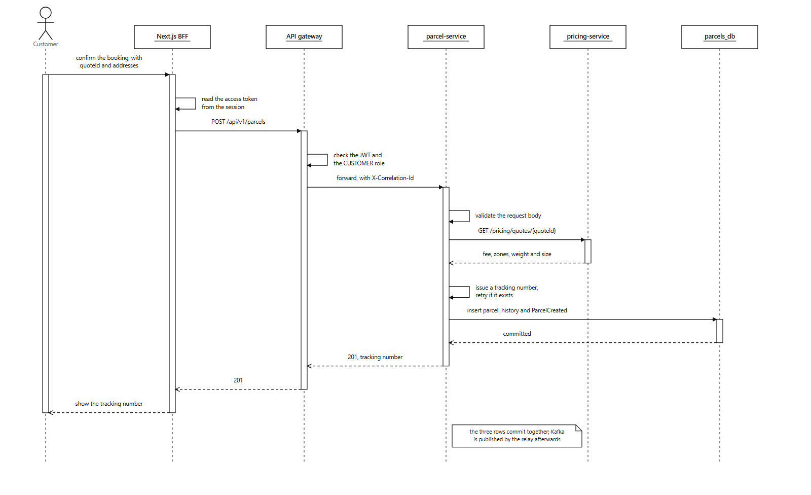

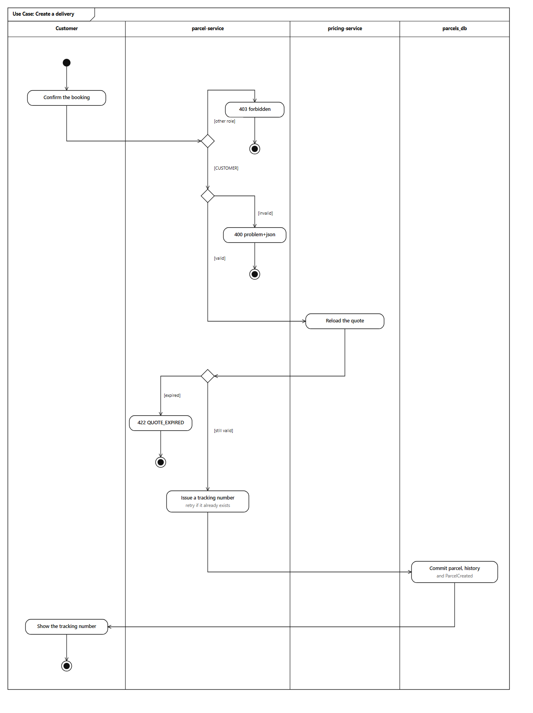

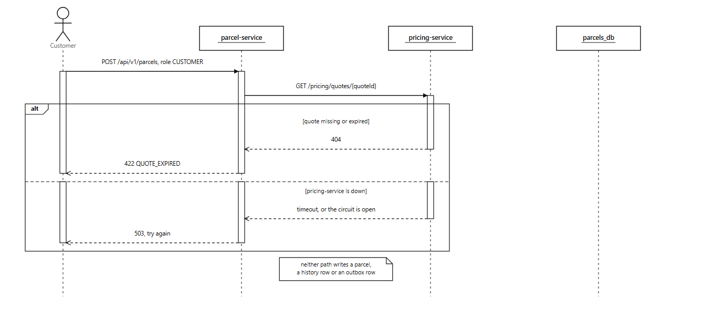

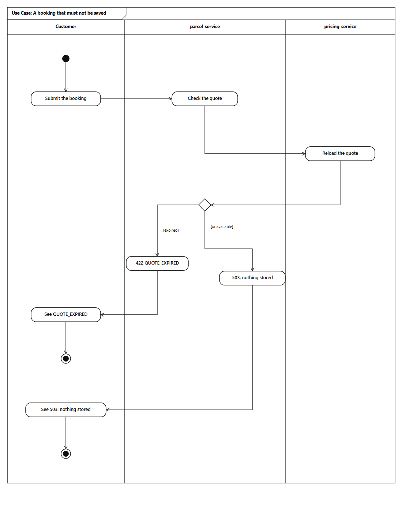

Success path, in order:

1. Customer confirms the booking in the Next.js UI.
2. BFF reads the access token from the session and `POST`s `/api/v1/parcels`.
3. Gateway checks the JWT and the `CUSTOMER` role, then forwards the call with `X-Correlation-Id`.
4. `parcel-service` validates the body.
5. `GET /api/v1/pricing/quotes/{quoteId}` returns fee, zones, weight, and size.
6. A tracking number is issued. A collision is retried.
7. Parcel, history, and `ParcelCreated` are inserted in one transaction.
8. `201` and the tracking number travel back through the gateway and the BFF.
9. The UI shows the tracking number.
10. Later, the relay publishes the outbox row. The HTTP handler does not wait for Kafka.

### 3.2 List my parcels

`GET /api/v1/parcels/mine`  
Returns only the caller's own page. Filters follow `mine(page, status)` on the controller: page, and an optional status.

### 3.3 View one parcel

`GET /api/v1/parcels/{id}`

The gateway forwards the JWT. The service loads the row, then applies `ParcelAccessPolicy`.

| Condition | HTTP | Body |
| --- | --- | --- |
| No row, or the caller may not see this parcel | `404` | `PARCEL_NOT_FOUND` |
| Caller is the owner, the assignee, the merchant, or staff | `200` | Parcel and history. Phone and addresses are decrypted. |

A refusal is the same `404` as a missing parcel. Decryption runs only after the policy allows the view.

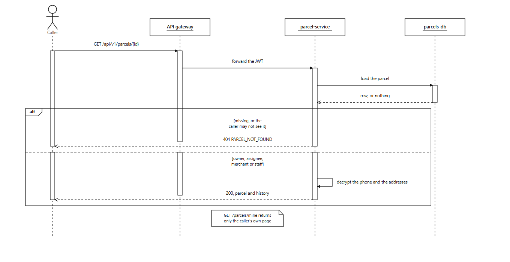

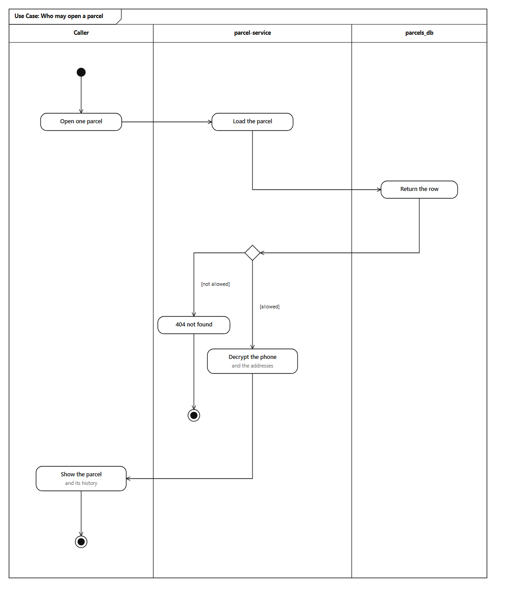

### 3.4 Cancel a parcel that has not been picked up

`POST /api/v1/parcels/{id}/cancel`  
Actor: the customer who owns the parcel.

| Condition | HTTP | Body | What is stored |
| --- | --- | --- | --- |
| No such parcel, or the caller is not the owner | `404` | `PARCEL_NOT_FOUND` | Nothing |
| Status is no longer `CREATED` | `422` | cancel is not allowed | Nothing |
| Owner, and status is `CREATED` | `200` | cancelled parcel | Status `CANCELLED`, history, `ParcelStatusChanged` outbox row |

After commit, the relay publishes `status-changed.v1`.

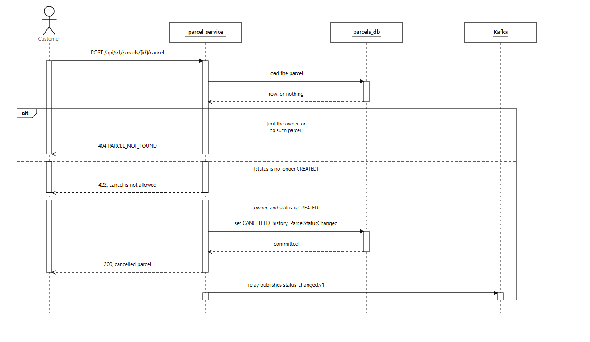

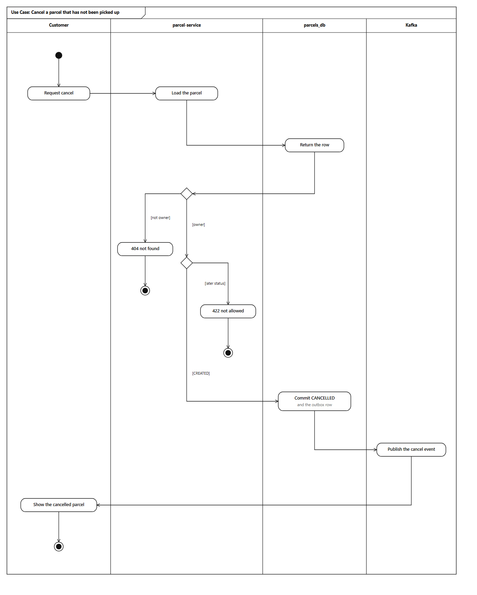

## 4. Application structure

`ParcelController` is the API adapter. It delegates create to `CreateParcelUseCase` and cancel to `CancelParcelUseCase`. Reads go through `ParcelQueryService`, which asks `ParcelAccessPolicy` before returning a parcel. A refused read is a `404`.

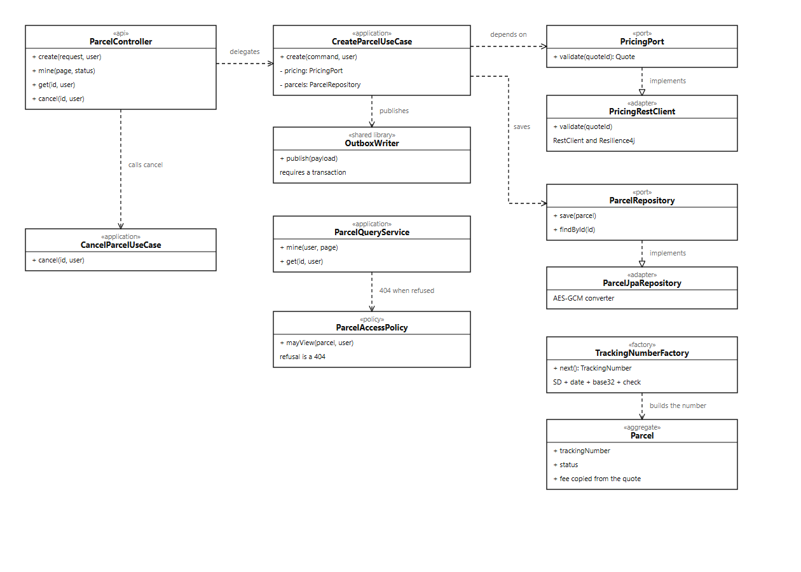

| Type | Name | Responsibility |
| --- | --- | --- |
| `«api»` | `ParcelController` | `create(request, user)`, `mine(page, status)`, `get(id, user)`, `cancel(id, user)` |
| `«application»` | `CreateParcelUseCase` | `create(command, user)`. Depends on `PricingPort` and `ParcelRepository`. Publishes through `OutboxWriter`. |
| `«application»` | `CancelParcelUseCase` | `cancel(id, user)` |
| `«application»` | `ParcelQueryService` | `mine(user, page)`, `get(id, user)` |
| `«policy»` | `ParcelAccessPolicy` | `mayView(parcel, user)`. Refusal is a `404`. |
| `«port»` | `PricingPort` | `validate(quoteId): Quote` |
| `«adapter»` | `PricingRestClient` | Implements the port with `RestClient` and Resilience4j. |
| `«port»` | `ParcelRepository` | `save(parcel)`, `findById(id)` |
| `«adapter»` | `ParcelJpaRepository` | JPA implementation. AES-GCM converter on the encrypted columns. |
| `«shared library»` | `OutboxWriter` | `publish(payload)`. Requires an open transaction. |
| `«factory»` | `TrackingNumberFactory` | `next(): TrackingNumber` as `SD` + date + base32 + check. |
| `«aggregate»` | `Parcel` | `trackingNumber`, `status`, fee copied from the quote. |

`OutboxWriter.publish` runs inside the same transaction as `ParcelRepository.save`. A rollback drops the parcel, the history row, and the outbox row together.

## 5. Data model — `parcels_db`

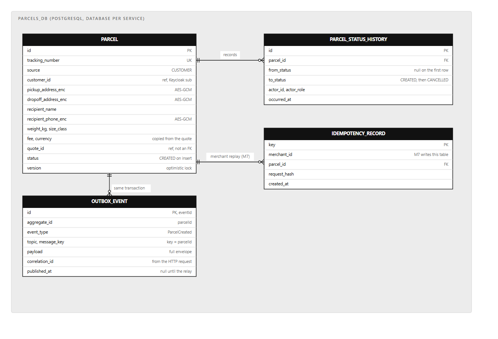

### 5.1 `parcel`

| Column | Constraint | Meaning |
| --- | --- | --- |
| `id` | PK | Parcel identifier. Also the Kafka message key. |
| `tracking_number` | UK | Issued by `TrackingNumberFactory`. |
| `source` | | `CUSTOMER` for this milestone. |
| `customer_id` | | Keycloak subject of the owner. |
| `pickup_address_enc` | | AES-GCM. |
| `dropoff_address_enc` | | AES-GCM. |
| `recipient_name` | | Plain text. |
| `recipient_phone_enc` | | AES-GCM. |
| `weight_kg`, `size_class` | | Taken from the quote. |
| `fee`, `currency` | | Copied from the quote at booking time. |
| `quote_id` | reference, not a foreign key | The M2 quote that was revalidated. |
| `status` | | `CREATED` on insert. Cancel sets `CANCELLED`. |
| `version` | | Optimistic lock. |

### 5.2 `parcel_status_history`

One parcel records many history rows.

| Column | Constraint | Meaning |
| --- | --- | --- |
| `id` | PK | |
| `parcel_id` | FK | |
| `from_status` | | Null on the first row. |
| `to_status` | | `CREATED`, then `CANCELLED`. |
| `actor_id`, `actor_role` | | Who caused the transition. |
| `occurred_at` | | When it happened. |

### 5.3 `outbox_event`

Written in the same transaction as the parcel.

| Column | Constraint | Meaning |
| --- | --- | --- |
| `id` | PK | Event id. |
| `aggregate_id` | | `parcelId`. |
| `event_type` | | `ParcelCreated` on booking. `ParcelStatusChanged` on cancel. |
| `topic` | | Booking uses `parcel.created.v1`. Cancel uses `status-changed.v1`. |
| `message_key` | | `parcelId`. |
| `payload` | | Full envelope. |
| `correlation_id` | | From the HTTP request (`X-Correlation-Id`). |
| `published_at` | | Null until the relay publishes the row. |

### 5.4 `idempotency_record`

This table lives in `parcels_db`. Milestone M7 (merchant replay) writes it. The customer booking path in these diagrams does not insert a row here.

| Column | Constraint | Meaning |
| --- | --- | --- |
| `key` | PK | |
| `merchant_id` | | Merchant that replayed the request. |
| `parcel_id` | FK | |
| `request_hash` | | |
| `created_at` | | |

## 6. Rules that cross the diagrams

**Who may create.** Only role `CUSTOMER`. Any other role is `403` before the quote is loaded.

**Who may view.** Owner, assignee, merchant, or staff. Everyone else, and a missing id, is `404 PARCEL_NOT_FOUND`. Phone and addresses stay encrypted until that check passes.

**Who may cancel.** The owner, and only while status is `CREATED`. A non-owner is `404`. A later status is `422`.

**Quote before write.** Booking revalidates the saved quote. Expired, missing, timeout, and an open circuit all leave the database unchanged: no parcel, no history row, no outbox row.

**One transaction, then the relay.** Parcel, history, and outbox commit together. The relay publishes afterwards. Create publishes `parcel.created.v1` (`ParcelCreated`). Cancel publishes `status-changed.v1` (`ParcelStatusChanged`). The message key is the parcel id.

**Fee is a copy.** `fee` and `currency` are copied from the quote onto the parcel. `quote_id` is stored as a reference and is not a foreign key into the pricing database.

**Secrets.** Pickup address, drop-off address, and recipient phone are AES-GCM columns. The JPA adapter converts them. The browser holds a session cookie; the BFF attaches the bearer token.

## 7. Diagram index

| File | Diagram |
| --- | --- |
| `diagrams/m3/01-use-cases.png` | Use cases for booking |
| `diagrams/m3/02-er-diagram.png` | `parcels_db` |
| `diagrams/m3/03-architecture.png` | Tiers from the booking UI to Kafka |
| `diagrams/m3/04-integration-design.png` | Synchronous reply and asynchronous publish |
| `diagrams/m3/05-seq-create-delivery.png` | Create delivery sequence |
| `diagrams/m3/06-seq-quote-rejected.png` | Quote expired or pricing unavailable |
| `diagrams/m3/07-seq-cancel.png` | Cancel sequence |
| `diagrams/m3/08-seq-read-parcel.png` | Read one parcel |
| `diagrams/m3/09-activity-create-delivery.png` | Create activity |
| `diagrams/m3/10-class-booking.png` | Booking classes, ports, and adapters |
| `diagrams/m3/11-activity-booking-rejected.png` | Booking that must not be saved |
| `diagrams/m3/12-activity-cancel.png` | Cancel activity |
| `diagrams/m3/13-activity-read-parcel.png` | Who may open a parcel |
