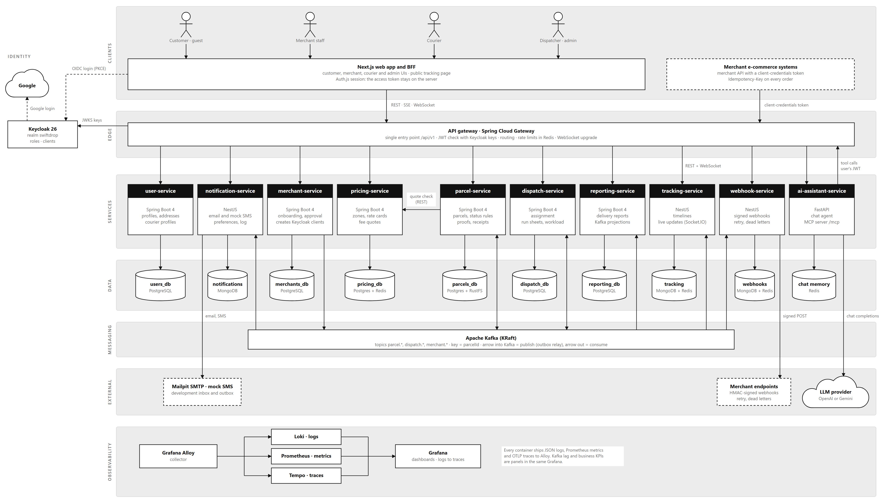

# SwiftDrop diagrams

Every design figure of the project: the whole system first, then one folder per milestone. All figures share one visual template, the M10 style: black on white, light grey tier bands, black-header boxes for services, and a clean sans-serif face.

## The template

- **Drawn figures** use the M10 drawing primitives in [`m10-reporting-ai-assistant/src/`](m10-reporting-ai-assistant/src/) (`draw.py`, `activity.py`, `eer.py`): the system figures, M3, M7, M8 and M10.
- **Mermaid figures** keep an editable `.mmd` and are rendered with the shared M10 theme [`_template/m10-mermaid.json`](_template/m10-mermaid.json): M1, M2, M4, M6 and M9.
- **File names** follow `NN-<type>-<topic>` (`01-use-cases`, `02-er-diagram`, `05-seq-...`, `10-activity-...`) inside folders named `m<N>-<feature>`.

Render a Mermaid figure:

```bash
npx -y @mermaid-js/mermaid-cli@11.4.2 -i 05-seq-google-login.mmd -o 05-seq-google-login.png \
  -c ../_template/m10-mermaid.json -s 2 -b white
```

## System

| Figure | Files |
|---|---|
| Architecture: every service, store and integration | [system/system-architecture.png](system/system-architecture.png) |
| Deployment: build, release and run | [system/system-deployment.png](system/system-deployment.png) |
| Event-driven integration: topics, producers, consumers | [system/system-event-flow.png](system/system-event-flow.png) |
| Data model: every database | [system/system-er-diagram.png](system/system-er-diagram.png) |
| EER diagram: the whole domain | [system/system-eer-diagram.png](system/system-eer-diagram.png) |



## Milestones

| Folder | Milestone | Issue | Owner | Figures |
|---|---|---|---|---|
| [`m1-identity-access/`](m1-identity-access/) | M1 Identity & Access | #14 | ThisukaMW | 8 |
| [`m2-pricing-zones/`](m2-pricing-zones/) | M2 Pricing & Zones | #15 | sasindu345 | 11 |
| [`m3-customer-booking/`](m3-customer-booking/) | M3 Customer Booking | #16 | Malshipahasara | 13 |
| [`m4-courier-operations/`](m4-courier-operations/) | M4 Courier Ops & Status Lifecycle | #17 | pamindu-w | 3 |
| [`m5-dispatch-workload/`](m5-dispatch-workload/) | M5 Dispatch & Workload | #18 | Chaniths | 12 |
| [`m6-real-time-tracking/`](m6-real-time-tracking/) | M6 Real-time Tracking | #19 | ashmax77 | 13 |
| [`m7-merchant-onboarding/`](m7-merchant-onboarding/) | M7 Merchant Onboarding & API | #20 | KavinuS | 13 |
| [`m8-webhooks-integration/`](m8-webhooks-integration/) | M8 Webhooks & External Integration | #21 | geemalfernando | 12 |
| [`m9-notifications-receipts/`](m9-notifications-receipts/) | M9 Notifications, History & Receipts | #22 | Sapuni-Pathirana | 13 |
| [`m10-reporting-ai-assistant/`](m10-reporting-ai-assistant/) | M10 Reporting & AI Assistant | #23 | Pasidu-Mihiranga | 12 |

`er-v1.mmd` is the first cross-service data model, kept for history; `system/system-er-diagram` replaces it.
