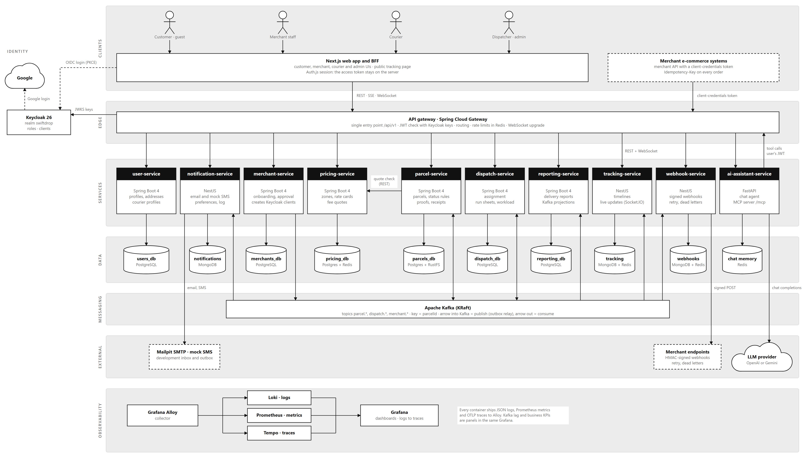
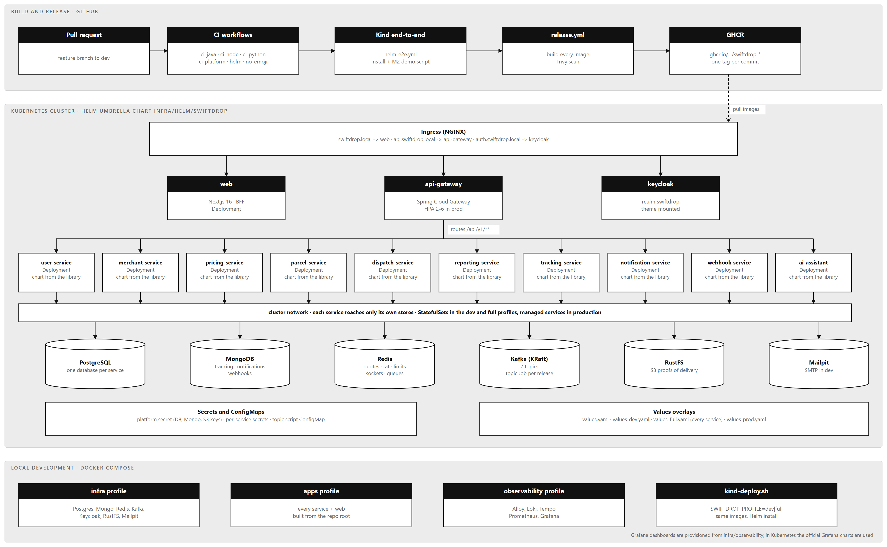
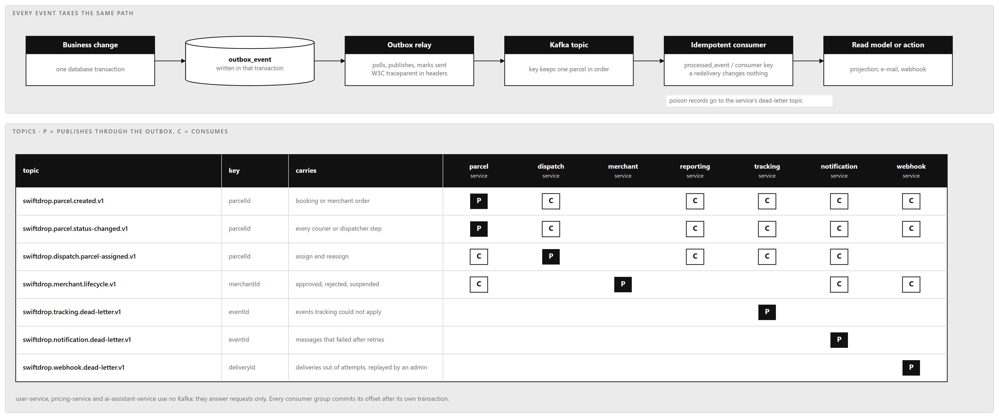
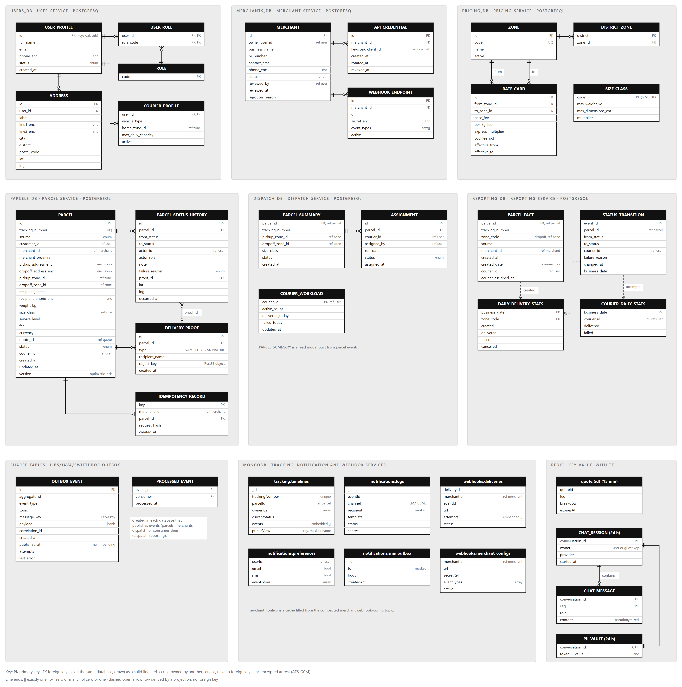
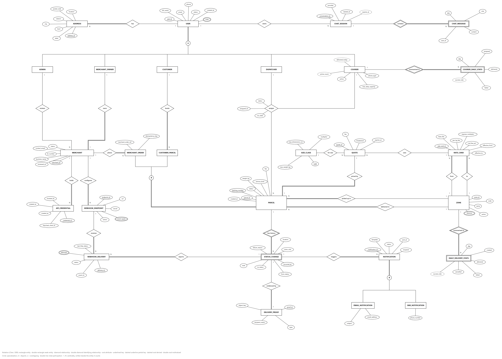

# System diagrams

Whole-system figures, drawn with the M10 Python drawing primitives (`../m10-reporting-ai-assistant/src/fig_system_*.py`, registered as `s1` to `s5` in `build_figures.py`).

## Architecture: every service, store and integration

[SVG](system-architecture.svg) · [PNG](system-architecture.png)

## Deployment: build, release and run

[SVG](system-deployment.svg) · [PNG](system-deployment.png)

## Event-driven integration: Kafka topics, producers and consumers

[SVG](system-event-flow.svg) · [PNG](system-event-flow.png)

## Data model: every database of every service

[SVG](system-er-diagram.svg) · [PNG](system-er-diagram.png)

## EER diagram: the whole domain in Chen notation

[SVG](system-eer-diagram.svg) · [PNG](system-eer-diagram.png)

[All diagrams](../README.md)
